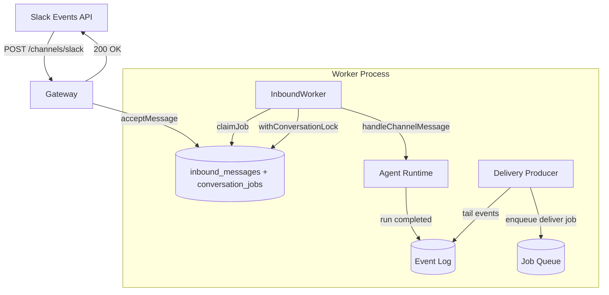

# Durable Inbound Queue — Persist Before Ack

## Problem

Today the gateway's channel route processes inbound messages **inline**: it calls `handleChannelMessage` (which starts/continues an agent turn) before responding to the webhook. If the process crashes mid-turn, the message is lost — Slack's retries are racy and time-bounded. In queue mode, the inbound _does_ enqueue a job, but the inbound message itself isn't persisted as a durable entity with dedupe, and there's no thread-level serialization.

## What factory has

Factory's Slack ingress (`src/web/routes/slack.ts` + `src/web/conversation-worker.ts`):

1. **Persist-before-ack**: `acceptSlackMessage()` atomically writes to `inbound_messages` (dedupe on `delivery_id`) and enqueues a `turn` job. Returns 200 immediately.
2. **Durable job queue**: `ConversationWorker` claims jobs with `FOR UPDATE SKIP LOCKED`, heartbeats the lease, and reaps stale jobs.
3. **Thread advisory lock**: `withThreadLock(threadKey, fn)` — Postgres `pg_advisory_xact_lock` serializes concurrent messages on the same thread so agents don't process two turns simultaneously.
4. **Atomic turn completion**: `completeTurn(job, messageId, completion)` — in one transaction: marks message processed, completes job, saves session snapshot, appends terminal events.

## Plan

### 1. SQL migration: `inbound_messages` + `conversation_jobs`

File: `packages/store/sql/0016_inbound_queue.sql`

```sql
CREATE TABLE IF NOT EXISTS inbound_messages (
    id              TEXT PRIMARY KEY,
    tenant_id       TEXT NOT NULL,
    delivery_id     TEXT NOT NULL,
    channel         TEXT NOT NULL,
    conversation_id TEXT NOT NULL,
    thread_id       TEXT,
    user_id         TEXT,
    input           JSONB NOT NULL,
    status          TEXT NOT NULL DEFAULT 'pending',
    created_at      TIMESTAMPTZ NOT NULL DEFAULT now(),
    processed_at    TIMESTAMPTZ,
    UNIQUE (tenant_id, delivery_id)
);

CREATE INDEX idx_inbound_tenant_status ON inbound_messages(tenant_id, status);
CREATE INDEX idx_inbound_conversation ON inbound_messages(tenant_id, channel, conversation_id);

-- RLS
ALTER TABLE inbound_messages ENABLE ROW LEVEL SECURITY;
CREATE POLICY tenant_isolation_inbound ON inbound_messages
    USING (tenant_id = current_setting('app.tenant_id', true))
    WITH CHECK (tenant_id = current_setting('app.tenant_id', true));

CREATE TABLE IF NOT EXISTS conversation_jobs (
    id              TEXT PRIMARY KEY,
    tenant_id       TEXT NOT NULL,
    message_id      TEXT NOT NULL REFERENCES inbound_messages(id),
    channel         TEXT NOT NULL,
    conversation_id TEXT NOT NULL,
    status          TEXT NOT NULL DEFAULT 'queued',
    locked_by       TEXT,
    locked_at       TIMESTAMPTZ,
    lease_token     TEXT,
    attempts        INTEGER NOT NULL DEFAULT 0,
    max_attempts    INTEGER NOT NULL DEFAULT 5,
    error           TEXT,
    created_at      TIMESTAMPTZ NOT NULL DEFAULT now(),
    updated_at      TIMESTAMPTZ NOT NULL DEFAULT now()
);

CREATE INDEX idx_conv_jobs_claimable
    ON conversation_jobs(tenant_id, status, created_at)
    WHERE status = 'queued';

ALTER TABLE conversation_jobs ENABLE ROW LEVEL SECURITY;
CREATE POLICY tenant_isolation_conv_jobs ON conversation_jobs
    USING (tenant_id = current_setting('app.tenant_id', true))
    WITH CHECK (tenant_id = current_setting('app.tenant_id', true));
```

### 2. InboundStore interface

File: `packages/store/src/inbound-store.ts`

```typescript
export interface InboundMessage {
  id: string;
  tenantId: string;
  deliveryId: string;
  channel: string;
  conversationId: string;
  threadId?: string;
  userId?: string;
  input: unknown;
  status: "pending" | "processing" | "processed" | "failed";
  createdAt: string;
  processedAt?: string;
}

export interface ConversationJob {
  id: string;
  messageId: string;
  channel: string;
  conversationId: string;
  status: string;
  leaseToken: string;
  attempts: number;
}

export interface AcceptMessageInput {
  deliveryId: string;
  channel: string;
  conversationId: string;
  threadId?: string;
  userId?: string;
  input: unknown;
}

export interface InboundStore {
  /** Atomically persist message + enqueue job. Returns false if delivery_id is a duplicate. */
  acceptMessage(input: AcceptMessageInput): Promise<boolean>;
  claimJob(workerId: string): Promise<ConversationJob | null>;
  heartbeatJob(jobId: string, leaseToken: string): Promise<boolean>;
  completeJob(jobId: string, leaseToken: string): Promise<void>;
  failJob(jobId: string, leaseToken: string, error: string, retry?: boolean): Promise<void>;
  reapJobs(staleBefore: Date): Promise<number>;
  getMessage(messageId: string): Promise<InboundMessage | null>;
  markProcessed(messageId: string): Promise<void>;
  /** Postgres advisory lock scoped to a conversation — serializes turns. */
  withConversationLock<T>(channel: string, conversationId: string, fn: () => Promise<T>): Promise<T>;
}
```

### 3. Refactor gateway channel route

Current flow (inline):
```
Slack → gateway → verify → match → parse → handleChannelMessage (runs turn) → 200
```

New flow (durable):
```
Slack → gateway → verify → match → parse → inboundStore.acceptMessage → 200 (immediate)
                                                     ↓ (async)
                                              InboundWorker claims job
                                                     ↓
                                              withConversationLock
                                                     ↓
                                              handleChannelMessage (runs turn)
```

The gateway channel route changes:
- After `parse`, call `inboundStore.acceptMessage({ deliveryId, channel, conversationId, input, user })`
- If duplicate (returns false), ack 200 silently
- If new, ack 200 immediately — the worker will process it

The `deliveryId` is constructed per-channel:
- Slack: `slack:{channel}:{messageTs}` (not event_id — same message arrives as both `app_mention` and `message`)
- GitHub: `github:{delivery_id_header}`
- Generic: hash of `(channel, conversationId, input)`

### 4. InboundWorker

File: `packages/sdk/src/inbound-worker.ts`

```typescript
export class InboundWorker {
  constructor(private opts: {
    inboundStore: InboundStore;
    runtime: AgentRuntime;
    handleMessage: (msg: InboundMessage) => Promise<void>;
    pollMs?: number;
    visibilityTimeoutMs?: number;
    concurrency?: number;
  }) {}

  start(): void { /* spawn N claim loops */ }
  async stop(): Promise<void> { /* graceful shutdown */ }
}
```

Each claim loop:
1. `claimJob(workerId)` — gets a job with lease
2. Start heartbeat interval (`visibilityTimeoutMs / 3`)
3. `inboundStore.withConversationLock(channel, conversationId, async () => { ... })`
4. Inside the lock: load message, drive the agent turn, mark processed
5. `completeJob` on success, `failJob` on error (with retry flag)
6. Periodic `reapJobs` for stale claims

### 5. Wire into existing worker

Two options (configurable via env):
- **Colocated** (default): the existing `runWorker` also runs an `InboundWorker` — one process handles both agent turns and inbound claiming
- **Standalone**: a separate `inbound-worker` entry point for horizontal scaling of inbound processing independently



## What stays the same

- The `Channel` interface is unchanged — `match`/`parse`/`deliver` still work
- `DeltaBus` and streaming continue to work
- The existing `run_jobs` queue handles agent turn execution and deliver jobs
- `deliverForRun` outbound delivery is unaffected
- Inline mode (local dev) can bypass the queue by setting `RENDER_FACTORY_INBOUND_MODE=inline`

## Migration path

The feature is opt-in via `RENDER_FACTORY_INBOUND_MODE=queue` (default remains `inline` for backward compatibility during rollout). The gateway checks this flag to decide whether to persist-then-ack or process inline.
