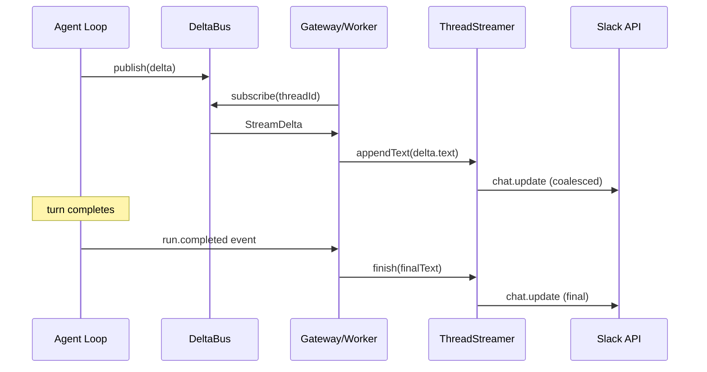

# ThreadStreamer — Slack Streaming Replies

## Problem

Today the `slackChannel().deliver` in `render-factory` posts a single `chat.postMessage` when a run completes. During a multi-minute agent turn, the Slack thread shows no activity — no typing indicator, no tool progress, no partial text. The user has no signal the bot is working.

## What factory has

`factory/src/lib/slack/streamer.ts` solves this with `ThreadStreamer`:
- Posts a placeholder ("_thinking..._") at turn start
- Accumulates token deltas and flushes via `chat.update` on a timer (~1.2s)
- Shows a tool trail (last N tools invoked) below the text
- Final update writes the authoritative reply (no lost text from race conditions)
- Handles failure (appends a warning or posts a new message if already finalized)
- Rate-limit safe (one update per interval, not per token)

Supporting code:
- `factory/src/lib/slack/client.ts` — retry-aware Slack API client (429 backoff, 5xx retry, exponential backoff)
- `factory/src/lib/slack/mrkdwn.ts` — Markdown → Slack mrkdwn converter (bold, links, headings, code, bullets)

## Plan

### 1. Create `packages/channels/slack/client.ts`

Lift factory's `SlackClient` interface and `createSlackClient(token)` with:
- `postMessage`, `updateMessage`, `addReaction`, `removeReaction`, `authTest`
- Retry loop (max 4 attempts) with exponential backoff
- 429 rate-limit handling (respect `Retry-After` header)
- 5xx retry
- Benign error set (`already_reacted`, `no_reaction`)

This replaces the raw `fetch` in the existing `slackChannel.deliver`.

### 2. Create `packages/channels/slack/mrkdwn.ts`

Lift factory's converter:
- `toMrkdwn(markdown)` — bold, italic, links, headings→bold, bullets, horizontal rules
- `clampForSlack(text, max?)` — trim to Slack's 3000-char block limit on a line boundary
- `escapeSlackText(text)` — entity-escape `&`, `<`, `>`
- Code fences pass through untouched (Slack renders them natively)

### 3. Create `packages/channels/slack/streamer.ts`

Lift `ThreadStreamer` from factory:
- Constructor: `{ client: SlackClient, channel, threadTs, clientMsgId?, intervalMs?, toolTrailLength? }`
- `start(placeholder?)` — posts initial message, returns `SlackMessageRef`
- `appendText(delta)` — accumulates text, schedules flush
- `noteTool(name, detail?)` — adds to tool trail
- `finish(finalText?)` — final `chat.update`, returns rendered text
- `fail(message)` — error handling (posts new message or appends to existing)
- Internal timer-coalesced `flush()` — one `chat.update` per interval

### 4. Wire streamer into the channel deliver path

The existing `DeltaBus` already carries `StreamDelta` events from the agent loop to subscribers. The integration point:



Two modes:
- **Inline mode** (gateway drives the turn): subscribe to `DeltaBus` in-process, feed deltas to `ThreadStreamer`, finalize on run completion.
- **Queue mode** (worker drives the turn): the worker subscribes to deltas for its run and streams. The gateway's SSE endpoint already does this for the web UI; the Slack streamer is an additional consumer.

The `slackChannel` gains an optional `streaming: true` config. When enabled:
- `deliver` is replaced by a streaming lifecycle: `start` on turn begin → `appendText` on deltas → `finish` on completion
- A `SlackStreamingDelivery` class wraps `ThreadStreamer` + `DeltaBus` subscription

## File structure

```
packages/channels/
  slack/
    client.ts        — retry-aware Slack API client
    mrkdwn.ts        — Markdown → mrkdwn
    streamer.ts      — ThreadStreamer
    index.ts         — re-exports
  package.json       — @render-factory/channels-slack
  tsconfig.json
```

## What stays the same

- The generic `Channel` interface is untouched
- The existing `slackChannel()` in `packages/sdk/src/channels/slack.ts` continues to work as-is (batch delivery)
- `DeltaBus` is read-only from the streamer's perspective
- No engine changes
