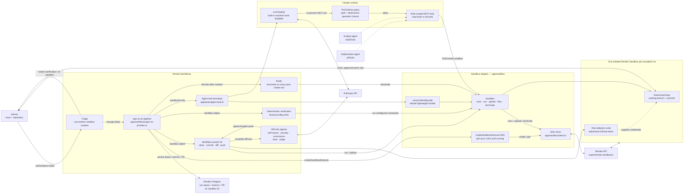

# render-factory

A reference for building a self-hosted software factory on
Render. It turns a labeled GitHub issue into a reviewed draft pull request
using Workflows, Sandboxes, Postgres, and Web Services.

[Patterns](#production-patterns-demonstrated) · [Run lifecycle](#run-lifecycle) ·
[Get started](#get-started) · [Deploy](#deploy-to-render) ·
[Adapt](#adaptation-seams) · [Safety](#safety-boundaries)

This repository is meant to be read, demonstrated, forked, and adapted.
It is not a general-purpose coding agent product or a claim that every factory needs eight agents.
The useful parts are the production boundaries: where state lives, which component holds
authority, how untrusted model actions are constrained, and where a human
remains in control.

## Use this reference when

- You want to run coding agents inside infrastructure you control.
- You need to show how Render Workflows, Sandboxes, and Web Services divide
  control-plane, execution, and ingress responsibilities.
- The design needs auditable Git changes, deterministic checks, scoped
  credentials, and a human approval boundary.

Use it as a pattern library, not a drop-in service. It is intentionally bound
to one repository and one issue-label trigger; multi-tenant authorization,
policy administration, billing, and fleet operations are outside its scope.

## Production patterns demonstrated

- **Thin ingress, privileged workflow.** The public gateway authenticates and
  dispatches; it runs no models and has no repository credential. This reduces
  the blast radius of an internet-facing service, at the cost of deploying and
  configuring the gateway and Workflows host separately.
- **Capabilities, not prompt promises.** Analysts receive read tools,
  implementers receive scoped write tools, and reviewers receive only diff
  text. Claude's built-in machine tools stay disabled. This makes access
  reviewable in code, but every new capability requires an explicit tool and
  policy decision.
- **Workflow-owned authority.** Models can propose and edit, but workflow code
  owns sandbox lifecycle, commits, verification, pushes, and PR creation. This
  makes safety properties deterministic; the tradeoff is more orchestration
  code and less agent autonomy.
- **Ephemeral execution, durable coordination.** Each accepted run gets one
  isolated sandbox while Postgres stores run state and idempotency records.
  Isolation and retries are easier to reason about, but sandbox startup adds
  latency and work must not depend on its filesystem surviving termination.
- **Layered quality gates.** Deterministic build and test commands run before
  parallel specialist review, a judge, remote-SHA verification, and a human
  draft-PR decision. More gates improve evidence, but add model cost and
  latency; smaller workflows may need fewer reviewers.
- **Short-lived, scoped source-control credentials.** A GitHub App mints
  installation tokens scoped to the target repository. They reach Git through
  a temporary askpass script and never enter prompts or remotes.

## Run lifecycle

1. The gateway validates a GitHub label event, claims an idempotent run in
   Postgres, and dispatches only an issue number and run ID.
2. Triage uses authoritative GitHub data before any sandbox is created. An
   unclear request returns questions without paying the isolation cost.
3. The workflow creates one sandbox, clones the configured repository, and
   creates a deterministic working branch.
4. A read-only analyst plans; an implementer edits; workflow code commits and
   runs configured verification commands, feeding failures back for repair.
5. Review agents inspect the complete diff without sandbox access. One
   requested revision may return to the implementer.
6. An approval allows workflow code to push, verify the remote SHA, and open a
   draft PR. Automation never marks it ready or merges it.
7. A `finally` block terminates the sandbox. The trigger label remains during
   the run so platform retries can re-read authoritative input; reapplying it
   after a terminal result starts a fresh run.

## Architecture

The detailed wiring below is included because it demonstrates a production
boundary: Workflow tasks share an ephemeral execution environment by ID
without giving the model authority to select or manage that environment.
That indirection improves isolation and observability, but couples the workflow
to sandbox availability and requires explicit cleanup.

<details>
<summary>Sandbox and task wiring</summary>



The sandbox is shared by ID across separate Workflow tasks. The top-level
workflow creates and always terminates it; agent code cannot select a sandbox
or use Claude's built-in filesystem and shell tools. Git commits, verification,
diff extraction, and the final push are handled in code
through the workflow-owned `Sandbox` handle.

</details>

Two processes deploy independently: the Hono gateway at `app/src/server.ts` and
the task-registration host at `app/src/workflows.ts`. The gateway runs no
models and holds no repository credential. Workflow code owns GitHub writes,
Git pushes, and sandbox lifecycle; agents receive only the sandbox operations
their role requires.

`GET /health` reports liveness. `GET /ready` checks Postgres and is the
deployed gateway health check.

## Where to look

- Start with `app/workflows/spec-to-pr/index.ts` for the control flow and
  `factory.config.ts` for configurable choices.
- Read `app/claude/run.ts`, `app/tools/`, and `app/policy/` together to inspect
  the model-to-machine trust boundary.
- Read `app/gateway/`, `app/store/`, and `app/git/` for ingress, idempotency,
  credential handling, and publishing.
- Use [AGENTS.md](AGENTS.md) as the implementation guide for adding agents,
  tasks, tools, and workflows.

## Get started

### Prerequisites

For a full end-to-end run you need:

- Node.js 22 or newer and npm
- Docker for the local Postgres service
- The Render CLI, installed and authenticated
- A Render workspace with access to Workflows and Sandboxes
- An Anthropic API key
- A GitHub repository and a fine-grained token

### Install and configure

```bash
git clone https://github.com/<you>/render-factory.git
cd render-factory
npm ci
cp .env.example .env
```

Fill in `.env` using the [configuration reference](#configuration). Start and
migrate Postgres first:

```bash
npm run dev:postgres
npm run db:migrate
```

Then run each process in a separate terminal:

- Gateway on `http://localhost:3000`: `npm run dev:gateway`
- Render Workflows host: `npm run dev:workflows`

`dev:workflows` requires the authenticated Render CLI. Local workflow runs
still create real Render Sandboxes; they do not execute repository code on your
development machine.

### Setup commands

```bash
npm run setup:app     # create a GitHub App via GitHub's manifest flow
npm run setup:github  # create the webhook and trigger label
npm run doctor        # diagnose the result; changes nothing
```

The setup scripts automate GitHub App creation and idempotent webhook/label
configuration. `doctor` is the operational contract: it checks credentials,
cross-service configuration, GitHub wiring, database schema, and task
registration, prints a fix for each failure, and is safe to run in CI.

Running `doctor` against a Render database from your laptop needs the external
connection string with `?sslmode=require` appended. The deployed services use
the internal string, which does not.

### Connect GitHub and run the factory

The webhook takes `issues` events at:

```text
https://<gateway-host>/webhooks/github
```

Use the same secret as `GITHUB_WEBHOOK_SECRET`. A gateway running only on
localhost needs a publicly reachable HTTPS tunnel before GitHub can deliver to
it.

Apply the trigger label (`factory:full-run` by default) to an issue, as a
login on the actor allowlist. Applying that label is the only way to start
work in this milestone.

Scope the GitHub App to the target repository, grant Contents, Issues, and
Pull Requests write permissions, and protect the default branch.

### Who the factory appears as

Comments and pull requests are attributed to the GitHub App
(`your-app[bot]`). The factory authenticates with installation tokens that
expire after an hour. Create an App with Contents, Issues, and Pull Requests
write permissions, install it on the target repository, then set
`GITHUB_APP_ID`, `GITHUB_APP_PRIVATE_KEY`, and `GITHUB_APP_INSTALLATION_ID`.
Commits are authored as `render-factory[bot]`.

## Configuration

| Variable | Service | Purpose |
|---|---|---|
| `FACTORY_GITHUB_ACTORS` | Gateway | Comma-separated GitHub logins allowed to apply the label; overrides `factory.config.ts` |
| `GITHUB_WEBHOOK_SECRET` | Gateway | HMAC secret; use at least 32 random characters |
| `RENDER_WORKFLOW_SLUG` | Gateway | Deployed Workflows service slug, without a task name |
| `DATABASE_URL` | Both | Postgres connection string |
| `ANTHROPIC_API_KEY` | Workflows | Claude Agent SDK credential |
| `GITHUB_APP_ID` | Workflows | GitHub App ID (required) |
| `GITHUB_APP_PRIVATE_KEY` | Workflows | App private key: PEM, escaped PEM, or base64 |
| `GITHUB_APP_INSTALLATION_ID` | Workflows | Installation on the target repository |
| `RENDER_API_KEY` | Both | Task dispatch on the gateway; Sandboxes on Workflows |
| `RENDER_WORKSPACE_ID` | Workflows | Workspace in which sandboxes are created |
| `GITHUB_API_URL` | Workflows | Optional GitHub API base URL override |
| `PORT` | Gateway | Optional HTTP port; defaults to `3000` |

The target repository is configured in `factory.config.ts` (not an env var).
Both processes must use the same Postgres database. `DATABASE_URL` points to
local Docker in `.env.example`; the gateway Blueprint wires its production
value automatically.

Development scripts load `.env`. The production commands `npm run start:gateway`
and `npm run start:workflows` do not; supply their environment through Render.

## Deploy to Render

1. Fork this repository.
2. Create a Blueprint from `render.yaml`. It provisions
   `render-factory-gateway` and `render-factory-db`.
3. Set the unsynced gateway variables listed in
   [Configuration](#configuration).
4. Deploy the Blueprint gateway once so its pre-deploy command migrates the
   database.
5. Create a Render Workflows service from the same repository, using:

   ```bash
   npm run start:workflows
   ```

6. Set the Workflows variables before it starts, using the Postgres **internal**
   connection string for `DATABASE_URL`.
7. Set the gateway's `RENDER_WORKFLOW_SLUG` to the Workflows service slug.
8. Point the GitHub `issues` webhook at `/webhooks/github`.

Render Workflows cannot currently be provisioned by Blueprints, and the
`Dockerfile` starts only the gateway — keep the Workflows host as a separate
service. The gateway runs `npm run db:migrate` as its pre-deploy command, so
the schema is applied before any new instance serves traffic.

## Adaptation seams

- **Repository policy:** start in `factory.config.ts` with the target
  repository, labels, model tiers, checkout path, and verification commands.
  Verification runs in workflow code—not by model assertion—and empty commands
  deliberately remove that evidence.
- **Agent roles:** add an agent when a separate context, model tier, or
  capability boundary is useful. Tools are runtime allowlists; giving an agent
  write access is a security decision, not prompt wording.
- **Workflow stages:** keep external input schema-validated, task payloads
  small, results serializable, and sandbox ownership inside `try/finally`.
  Additional stages improve specialization and observability but add latency,
  model cost, and more retry behavior to reason about.
- **Review depth:** reduce or expand the specialist fan-out to match your risk
  tolerance. Deterministic checks should remain independent of model review,
  and the human draft-PR boundary should remain explicit.

See [AGENTS.md](AGENTS.md) for file-level registration steps, extension
conventions, security invariants, and test ownership.

## Safety boundaries

- The webhook signature is checked before the body is parsed or dispatched.
- One deployment is bound to one validated target repository from `factory.config.ts`.
- Only `issues.labeled`, from a human on the actor allowlist, starts a run.
  Bots, pull requests, other repositories, and other events are skipped.
- The gateway never receives the repository token.
- Claude's built-in filesystem and shell tools are not exposed to app agents,
  so every action an agent takes goes through a workflow-owned sandbox.
- `checkToolCall` runs as a Claude `PreToolUse` hook and vetoes destructive
  commands, secret exfiltration, and paths outside the checkout.
- Malformed structured model output fails closed after one repair attempt.
- The GitHub token never enters a prompt, a Git remote URL, or a command line;
  it reaches Git through a temporary askpass script.
- The factory signs a short JWT with the app's private key and exchanges it
  for an installation token that expires within the hour.
- The reviewed local commit must match the remote SHA before a PR is created.
- Secret-shaped strings are redacted from anything posted to GitHub.
- Automation ends at a draft PR; readiness and merge remain human decisions.

## Current limitations

- Every accepted issue, including one run from local development, creates a
  real sandbox and invokes multiple model tasks.
- One deployment is bound to one GitHub repository.
- Intake is limited to a maintainer applying one issue label.
- There is no public chat API, PR review trigger, or automatic PR follow-up.
- Only one implementation/review revision is attempted; unresolved findings
  stop without a PR.
- A failed task run is not resumed, and retrying repeats task model calls.
- Issue context, repository snapshots, tool output, and review diffs are
  bounded. Large specifications or monorepos may need different limits and
  retrieval strategies.
- Diffs over 200,000 characters and binary diffs fail closed.
- Render Workflows must be created separately from the Blueprint, and Workflows
  and Sandboxes product access is required.
- Render service filesystems are ephemeral; anything that must outlive a
  process belongs in Postgres.

## Development and verification

```bash
npm run check                        # Biome lint, TypeScript, and Vitest
npx vitest run tests/gateway.test.ts # one focused suite
npm run doctor                       # diagnose a live deployment
render blueprints validate           # when render.yaml changes
```

## License

MIT
