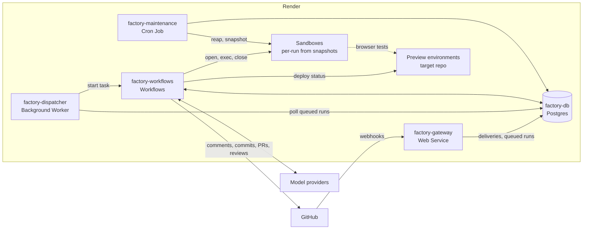
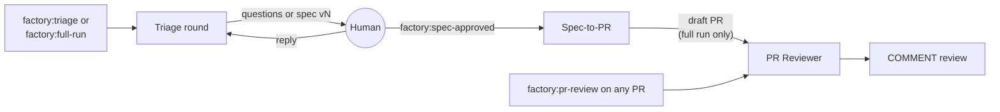

# render-factory 0.1.0 specification

> **Historical.** This is the 0.1.0 design, kept for reference. It is superseded by [redesign.md](redesign.md), and the system as built is described in [architecture.md](architecture.md) and the other current docs. Names, resources, and behavior below (the dispatcher, the maintenance cron, Postgres run state, and more) no longer exist.

| | |
|---|---|
| Status | Draft |
| Version | 0.1.0 |
| Date | 2026-10-05 |
| Base | `code-factory-demo` at `65e7cc7` (`npm run check` green: lint, typecheck, 105 tests) |
| Scope | Everything needed to implement 0.1.0. Things deliberately not built are listed in §17. |

This specification describes how to evolve `code-factory-demo` into render-factory 0.1.0. The demo has no other purpose now, so changes land in that repository directly. The demo is not rewritten. Each section says what stays, what changes, and what is added, by file path. §16 orders the work into milestones, each with a concrete check for when it is done.

**Tags.** **(D-nn)** marks a decision we agreed on ([Appendix A](#appendix-a-decision-log)). **(B-nn)** marks a default chosen while writing, which should be confirmed ([Appendix B](#appendix-b-defaults-to-confirm)). **(O-nn)** marks a platform fact still to verify ([Appendix C](#appendix-c-open-items)).

## Contents

1. [What changes, in one page](#1-what-changes-in-one-page)
2. [Target architecture](#2-target-architecture)
3. [The phase model](#3-the-phase-model)
4. [Workflows](#4-workflows)
5. [The Specification artifact](#5-the-specification-artifact)
6. [Changes by module](#6-changes-by-module)
7. [Data model](#7-data-model)
8. [Publishing through the Git Data API](#8-publishing-through-the-git-data-api)
9. [Workspaces and snapshots](#9-workspaces-and-snapshots)
10. [Agents, runners, and tools](#10-agents-runners-and-tools)
11. [Observability, cost, and the trace UI](#11-observability-cost-and-the-trace-ui)
12. [Configuration and environment](#12-configuration-and-environment)
13. [Security model](#13-security-model)
14. [Deployment and onboarding](#14-deployment-and-onboarding)
15. [Testing and evals](#15-testing-and-evals)
16. [Implementation plan](#16-implementation-plan)
17. [Out of scope and extension points](#17-out-of-scope-and-extension-points)
- [Appendix A: Decision log](#appendix-a-decision-log)
- [Appendix B: Defaults to confirm](#appendix-b-defaults-to-confirm)
- [Appendix C: Open items](#appendix-c-open-items)

---

## 1. What changes, in one page

**Today**, the demo has one workflow, `spec-to-pr`. A maintainer on an allowlist labels an issue `factory`. The gateway checks the webhook and starts the task directly. The workflow then runs the whole chain in one sandbox: triage with no checkout, analyst, implementer, verification, self-review, three parallel reviewers and a judge, a push from inside the sandbox, and a draft PR. If triage needs more detail, the run ends and the maintainer reapplies the label.

**After 0.1.0**, there are three workflows, each covering one *phase*, and the phases are chained together through GitHub:

| Phase | Started by | Ends with |
|---|---|---|
| **Triage** | `factory:triage` or `factory:full-run` on an issue, or a human reply while the conversation is open | Questions, a new spec version, or a decline, posted on the issue |
| **Spec-to-PR** | `factory:spec-approved` on an issue | A draft PR implementing the approved spec version |
| **PR Reviewer** | `factory:pr-review` on a PR, or automatically after Spec-to-PR during a full run | One COMMENT review, informed by specialist reviewers, verification, and UX testing against local dev and the preview environment |

The design follows a few principles:

- **Phases, not pauses (D-03).** A run never waits for a human. It finishes its phase, posts the result, and ends. The human's response starts the next run, which reads its state from Postgres and GitHub. This is how the demo already handles clarification, generalized to every human interaction.
- **Thin ingress, small dispatcher (D-11).** The gateway only writes rows. A small Background Worker polls the `runs` table and starts Workflow tasks.
- **Workflow-owned effects (D-20).** Only workflow code writes to GitHub. Every write first looks for a hidden marker, so a retry finds the earlier write instead of duplicating it. The demo's `ensureIssueComment` and `ensurePull` already work this way.
- **Credential-free execution (D-09, D-22).** Model keys never enter a sandbox. A read-only GitHub App token is present only while cloning or fetching. Pushes happen through the Git Data API from the Workflows service, with a tree-hash check.
- **Platform-native network control (D-13).** Sandbox egress is set by Render's native sandbox network policy, configured once in `factory.config.ts`. The factory adds no isolation machinery of its own.
- **One config file (D-30).** Repository targets and every tunable live in `factory.config.ts`.

**Already in the demo and kept:**

- the gateway's signature-before-parse check, body cap, and filters;
- the `agentTask()` factory and named tool sets;
- Claude with built-in tools disabled, plus the `PreToolUse` policy;
- structured output that fails closed (`agentJson`);
- verify-and-repair driven by the config;
- lookup-by-marker GitHub writes;
- GitHub App authentication and the manifest-flow setup;
- `doctor`;
- module barrels with one-way dependencies;
- tests that use fakes.

---

## 2. Target architecture

### 2.1 Render resources

| Resource | Render type | Entry point | Job |
|---|---|---|---|
| `factory-gateway` | Web Service | `app/src/server.ts` | Verifies webhooks, records deliveries, creates queued runs, sets cancel flags; serves the read API, the trace UI, and artifact links |
| `factory-dispatcher` | Background Worker (new) | `app/src/dispatcher.ts` | Polls queued runs and starts their Workflow task |
| `factory-workflows` | Workflows | `app/src/workflows.ts` | Runs the three workflows and all agent tasks; owns GitHub writes and publishing |
| `factory-maintenance` | Cron Job (new) | `app/src/maintenance.ts` | Re-queues stuck dispatches, fails runs that stopped heartbeating, reaps sandboxes, keeps the repository snapshot current, expires artifacts |
| `factory-db` | Postgres | — | All state, including artifacts |
| Sandboxes | Render Sandboxes | — | All repository execution |
| Preview environments | The *target* repository's Blueprint | — | Per-PR deploys that the PR Reviewer tests against |

These match the seed's list of primitives, plus one Background Worker. Every service, including the Workflows service, is provisioned from `render.yaml` (D-36).



### 2.2 Credential placement

| Credential | Gateway | Dispatcher | Workflows | Maintenance | Sandboxes |
|---|---|---|---|---|---|
| `DATABASE_URL` | yes | yes | yes | yes | — |
| `GITHUB_WEBHOOK_SECRET` | yes | — | — | — | — |
| `FACTORY_ADMIN_TOKEN` | yes | — | — | — | — |
| `RENDER_API_KEY` | — | yes | yes | yes | — |
| GitHub App credentials | — | — | yes | yes | Read-only token, present only during clone or fetch |
| Model provider keys | — | — | yes | — | — |

The gateway in the demo holds `RENDER_API_KEY` today. Moving task starts to the dispatcher removes it from the only internet-facing service.

---

## 3. The phase model

### 3.1 Triggers

| Event | Condition | Starts |
|---|---|---|
| `issues.labeled` `factory:triage` | — | A Triage round |
| `issues.labeled` `factory:full-run` | — | A Triage round with `autoAdvance: true` |
| `issue_comment.created` on an issue | The issue carries `factory:triage` or `factory:full-run` (the conversation is open), and the comment is from a human, has no factory marker, and is not a command | The next Triage round |
| `issues.labeled` `factory:spec-approved` | — | Spec-to-PR for the issue's current spec version. `autoAdvance` is true if the issue also carries `factory:full-run`. |
| `pull_request.labeled` `factory:pr-review` | — | PR Reviewer at the PR's current head SHA |
| Spec-to-PR completes with `pr_opened` and `autoAdvance` | — | PR Reviewer, queued in the same transaction that finishes Spec-to-PR |
| `issue_comment.created` beginning with `/factory cancel` | A non-terminal run exists for the subject | Nothing new; sets `cancel_requested_at` on that run |

Label names and the command prefix are configurable (D-05, D-07). The gateway gets the issue's labels from the webhook payload, so it needs no GitHub credential to decide whether a conversation is open.

Approving and implementing happen together (D-05). An approved spec that is not implemented is not a useful state, so one label covers both. To retry implementation, a human removes `factory:spec-approved` and applies it again.

### 3.2 Runs, subjects, and uniqueness

A run belongs to one **subject**: an issue or a PR in the target repository. At most one non-terminal run may exist per subject. This is the demo's `runs_one_active_per_issue` index, generalized to `(repo, subject_kind, subject_number)`.

When a trigger arrives while a run is already active on that subject, the delivery is recorded as `duplicate_active_run` and nothing else happens (B-03). There are two exceptions, and the running workflow handles both itself when it finishes:

- **Replies that arrive during a Triage round.** At completion, Triage compares the newest human comment with the last comment it read. If newer comments exist, it queues another round in the same transaction that finishes the current run (B-03).
- **An approval applied during a Triage round.** The approval would bind to a version that is about to be replaced, so the round removes the label when it finishes and asks for approval of the new version (B-04).

### 3.3 Run statuses

| Status | Meaning |
|---|---|
| `queued` | Created by the gateway or by a finishing run; waiting for the dispatcher |
| `dispatched` | The dispatcher called start-task |
| `running` | The workflow claimed the run (compare-and-set from `queued` or `dispatched`) and is sending heartbeats |
| `completed` | Finished with an outcome |
| `failed` | Error, lost execution, or dispatch failure |
| `cancelled` | Stopped by `/factory cancel` |

Each workflow defines its own outcomes (§4).

### 3.4 Labels during a run

| Label | Removed when |
|---|---|
| `factory:triage`, `factory:full-run` | Triage ends with `declined` or `failed`, or Spec-to-PR starts (the conversation is closed) |
| `factory:spec-approved` | Spec-to-PR reaches any terminal status. Removing it means applying the label again retries. |
| `factory:pr-review` | PR Reviewer reaches any terminal status |

Status labels are cosmetic and move to the `factory-status:` prefix (B-05). Today, `isStatusLabel` in `spec-to-pr/labels.ts` matches every `factory:` label, so its cleanup would also remove the new trigger labels.



---

## 4. Workflows

### 4.1 Common lifecycle: `app/workflows/lifecycle.ts` (new)

Every workflow is registered through `runWorkflow(name, handler)`. It handles the parts every run shares, so each workflow file reads as its phase only:

1. Parse `{ runId }`. Task inputs carry only the run ID; everything else is loaded from Postgres.
2. Claim the run: `UPDATE runs SET status = 'running' WHERE id = $1 AND status IN ('queued', 'dispatched')`. If no row updates, this is a duplicate start, so return the stored result.
3. Start a 30-second heartbeat on `runs.heartbeat_at` (B-01).
4. Check that the triggering actor (the label sender or comment author) has at least `minimumPermission` on the repository, via the GitHub collaborator-permission API (D-08, O-7). If not, comment and finish as `rejected`.
5. Check the trigger is still valid. The trigger label must still be present; a PR under review must still be open.
6. Run the handler. It receives `stage(name)` for span events, `cancelled()` (checked at stage boundaries), a budget check, and workspace helpers.
7. In `finally`, close every sandbox opened by the run.
8. On a terminal result:
   - write the outcome, and queue any follow-up run, in one transaction;
   - post the terminal comment through `ensureIssueComment`;
   - remove labels per §3.4;
   - set the status label.
9. On an error: redact the message, finish as `failed`, and comment with a link to the run in the trace UI.

This replaces the try/catch, label, and outcome handling inline in today's `spec-to-pr/index.ts`.

### 4.2 Triage: `app/workflows/triage/` (new)

Each run is one round of the conversation.

| Stage | What happens |
|---|---|
| `intake` | Load the issue, its comments, and the issue's current spec with its saved notes, if there is one. |
| `workspace` | Open a sandbox at the base branch (D-14). |
| `assess` | The `triage` agent, now with read tools on the checkout, returns `ask` (with questions), `draft`, or `decline` (with a reason). If a spec already exists, `draft` means revise it using the new comments. |
| `ask` | Post the questions as one comment. Outcome `asked`. |
| `draft` | The `spec-writer` agent (read tools) produces a `Spec` plus notes for later rounds. Workflow code validates it (§5.2), stores a new version, and creates or edits the spec comment in place. If `factory:spec-approved` is on the issue, remove it and say so (B-04). Outcome `spec_drafted`. |
| `decline` | Post the reason. Outcome `declined`. |

Rounds are unlimited (B-16). The conversation stays open as long as the triage label is present and no spec version has been approved.

### 4.3 Spec-to-PR: `app/workflows/spec-to-pr/` (changed)

Today, this file is the whole pipeline. It becomes the implementation phase only. Triage moves out, and the review fan-out moves to PR Reviewer.

| Stage | What happens | Change from the demo |
|---|---|---|
| `intake` | Load the spec version recorded in the run's input. If there is none, comment and finish `no_spec`. Mark that version approved by the trigger actor. Remove the conversation labels. | Replaces `loadIntake`, which ran the triage agent |
| `workspace` | Open a sandbox and create the branch `factory/issue-<n>-<runId16>` at the base SHA | Replaces `createSandbox` plus `setupCheckout` |
| `implement` | `implementer` works from the spec; workflow code commits | The input is the approved spec instead of the analyst's plan. The analyst becomes `spec-writer` in Triage. |
| `verify` | `verifyWithFixes`, using the repository target's `verify` commands, with at most `limits.repairRounds` (2) repair rounds. If it still fails, finish `verification_failed`. | `MAX_VERIFY_ROUNDS` (3) becomes config |
| `self-review` | `selfReview` checks the full diff against the spec. One fix pass is allowed, then verification runs again. Unfixed issues are listed in the PR body. | Unchanged, except the input is the spec |
| `publish` | Git Data API publish with tree verification (§8). Refusals finish `publish_refused`. | Replaces `verifyPush` |
| `pull-request` | `ensurePull` opens a draft PR, then a link comment is posted on the issue | PR body now carries the spec checklist and verification evidence |
| `complete` | Outcome `pr_opened`. If `autoAdvance` is set, queue a PR Reviewer run for the new PR. | New |

Removed from this workflow: the `triage` call, `reviewDiff`, the judge-driven revision round, and outcome `changes_requested`.

Other outcomes: `no_changes`, `verification_failed`, `publish_refused`, `budget_exceeded`, `no_spec`, `rejected`.

### 4.4 PR Reviewer: `app/workflows/pr-review/` (new)

**Input:** `{ prNumber, headSha }`. The head SHA comes from the label payload, or from Spec-to-PR's published commit.

| Stage | What happens |
|---|---|
| `intake` | Load the PR. If it is closed, finish `pr_closed`. Load the diff against the base. Find the spec through the PR body marker, falling back to the linked issue. |
| `workspace` | Open a fresh sandbox, fetch `refs/pull/<n>/head`, check out `headSha`, and reinstall if the lockfile changed (B-10). |
| `verify` | Run the `verify` commands and record their results as evidence. Failures do not stop the review. |
| `specialists` | Run each specialist listed in `review.specialists` in parallel with `ctx.run` (D-18, O-11). The default list is `security`, `correctness`, `performance`, and `tests`. Each specialist gets read tools on the PR checkout, the diff, the spec, and the verification results. Each returns findings with file, line, severity, confidence, and evidence. |
| `local-ux` | Start `dev.start` in the background, poll `dev.healthPath`, then run `ux-tester` with browser tools limited to `localhost:<port>`. Screenshots become artifacts. This stage is skipped if the server does not become healthy, and the dev log is attached instead (O-8). |
| `preview-ux` | If a preview is configured, poll the Render API until the preview deploy for `headSha` is live, for up to 20 minutes (D-19, O-4). Then run `ux-tester` against the preview URL. If there is no preview or it times out, skip the stage and say so. |
| `synthesize` | `synthesizer` (replacing `judge`) merges the specialist findings, verification evidence, and UX reports into a summary and inline comments. Workflow code checks every inline position against the diff hunks and moves invalid ones into the summary. |
| `submit` | Submit one review with `event: "COMMENT"` and `commit_id: headSha`, found by marker before creating (D-18). The body contains a verification table, findings grouped by specialist, UX results with screenshot links, and the preview status. |

**Outcomes:** `review_submitted`, `pr_closed`, `budget_exceeded`, `rejected`.

The factory never approves a PR and never requests changes. Adding a specialist takes one agent file under `app/agents/reviewers/` plus one entry in the config.

---

## 5. The Specification artifact

### 5.1 Storage

Spec versions live in Postgres (`specs`, `spec_versions`) and are the source of truth. The issue shows the current version in one comment, edited in place. The comment is found by the marker `<!-- render-factory:spec:<specId> -->`, and its ID is cached in `specs.comment_id`. If a human edits that comment, the next version overwrites the edit.

### 5.2 Schema: `app/contracts/spec.ts` (new)

```ts
interface Spec {
  title: string;
  summary: string;
  problem: string;
  goals: string[];
  nonGoals: string[];
  acceptanceCriteria: Array<{
    id: string;                                  // "AC-1"
    text: string;
    verification: "automated" | "ux" | "manual"; // "ux" criteria drive ux-tester
  }>;
  approach: string;
  affectedAreas: Array<{ path: string; change: string }>;
  testPlan: string;
  risks: string[];
  assumptions: string[];
  openQuestions: string[];
}
```

Validation is done by workflow code. A spec must have at least one acceptance criterion and unique criterion IDs. Paths that do not exist in the checkout produce a warning, shown in the comment, because new files are legitimate.

Each `spec_versions` row also stores:

- `notes`: the triage findings and relevant paths, so the next round does not repeat the research;
- `last_comment_id`: the newest human comment that version took into account.

### 5.3 Approval

The gateway records `specs.current_version` in the Spec-to-PR run's input when the label is applied. No Triage run can be active then, because of the one-active-run rule, so that is the version the human saw. Spec-to-PR implements exactly that version. Re-triaging an issue that already has an approved spec creates a new spec, and the old one is marked `superseded`.

---

## 6. Changes by module

Paths are relative to `code-factory-demo`. The dependency direction becomes `sandbox → tools → runners → agents → tasks → workflows`, with `workspaces` and `publish` used by `workflows`. Leaves stay leaves.

### 6.1 Repository hygiene

| Item | Change |
|---|---|
| `app/store/pool.ts` | Revert the uncommitted edit, which imports `pg` from `../../node_modules/@types/pg/index.js`. |
| `tmp/` | Delete. It describes earlier Redis and Key Value designs that would mislead readers. |
| `.github/workflows/ci.yml` | CI calls `npm run test:integration`, which does not exist. Add the script (§15.2). |
| `package.json` | Version `0.1.0`. Upgrade `@renderinc/sdk` from `^0.7.0` to `^1.x` (§6.2). Add `@openai/agents` and `playwright-core`, the latter for the browser driver's type definitions only. |
| `docs/` | Add this spec as `docs/0-1-0-spec.md`. |

### 6.2 Render SDK upgrade (D-36)

SDK 1.x changes the task signature to `(ctx, ...args)`, and child tasks are called with `ctx.run(task, args)`. The demo calls tasks directly, as in `analysisTask({ message })`. Update `app/tasks/agent-task.ts` and every workflow. Confirm the sandbox client in `app/sandbox/client.ts` (`render.experimental.sandboxes`) against 1.x, and add `download` for screenshots and archives (O-1).

### 6.3 `app/config/`

| File | Today | Change |
|---|---|---|
| `env.ts` | `repository()` reads `FACTORY_REPO`; `triggerLabel()` reads `FACTORY_LABEL`; `allowedActors()` reads `FACTORY_GITHUB_ACTORS` or `factoryConfig.actors` | `repository()` returns `factoryConfig.repos[0]`. Labels come from config. `allowedActors` is deleted, replaced by the live permission check (D-08). |
| `assert.ts` | `assertGatewayEnv` requires the Render key and slug; workflows require App or PAT credentials | Per-process assertions for gateway, dispatcher, workflows, and maintenance (§12.2). App credentials only (D-22). |
| `validate.ts` (new) | — | Validates `factory.config.ts` at startup: exactly one repo, distinct labels, a command prefix that starts with `/`, a model for every tier and runner in use, a `verify` list (a warning if empty), a valid `preview` block. |

### 6.4 `app/contracts/`

| File | Change |
|---|---|
| `input.ts` | Root workflow input becomes `{ runId }`. Agent task input is `{ runId, message, sandboxId? }`. |
| `result.ts` | One result union per workflow, with the outcomes in §4. |
| `triage.ts` | `{ decision: "ask" \| "draft" \| "decline", questions, rationale, findings, relevantPaths }` |
| `spec.ts` (new) | The `Spec` schema (§5.2) and `SpecNotes` |
| `review.ts` | `findingSchema` gains `line`, `specialist`, and `evidence`. `judgeSchema` becomes `synthesisSchema` (`summary`, `riskTier`, `comments[]`) with no approve-or-request-changes decision. |
| `ux.ts` (new) | Results per acceptance criterion (`pass`, `fail`, or `inconclusive`), observations, and screenshot artifact IDs |
| `implementation.ts` | Unchanged |

### 6.5 `app/gateway/`

| File | Change |
|---|---|
| `webhook.ts` | Accept `issues` (labeled), `issue_comment` (created), and `pull_request` (labeled), and map them to the intents in §3.1. Keep the signature check before parsing, the body cap, the repository match, and the bot filter. Replace the actor allowlist with an `author_association` pre-filter on comments (`OWNER`, `MEMBER`, `COLLABORATOR`), followed by the live check in the workflow. Drop comments that carry a factory marker. Write a `deliveries` row and either a queued run or a cancel flag, in one transaction. Return `202`. |
| `schema.ts` | Add schemas for `issue_comment` (with `issue.labels` and `comment.author_association`) and for `pull_request` (with `head.sha`). |
| `dispatch.ts` | Delete. The gateway no longer starts tasks. |
| `api.ts` (new) | Read-only JSON behind `Authorization: Bearer <FACTORY_ADMIN_TOKEN>`: `GET /api/runs`, `/api/runs/:id`, `/api/runs/:id/events`, `/api/runs/:id/artifacts`, `/api/specs/:id`, `/api/deliveries`. No versioning promises (D-33). |
| `ui/` (new) | Trace UI (§11.3) |
| `artifacts.ts` (new) | `GET /a/:token` artifact links (§11.4) |
| `app.ts` | Mount the new routes. `/health` and `/ready` are unchanged. |

### 6.6 `app/dispatcher/` (new)

- `loop.ts`: every 2 seconds (B-02), claim queued runs and start them:

  ```sql
  UPDATE runs SET status = 'dispatched', dispatched_at = now(),
                  dispatch_attempts = dispatch_attempts + 1
  WHERE id IN (
    SELECT id FROM runs
    WHERE status = 'queued' AND dispatch_after <= now()
    ORDER BY created_at
    FOR UPDATE SKIP LOCKED
    LIMIT 10
  )
  RETURNING id, workflow;
  ```

  For each claimed run, call `startTask(`${RENDER_WORKFLOW_SLUG}/${workflow}`, [{ runId }])`.

  - On a retryable error, return the run to `queued` with `dispatch_after` pushed back by an exponential delay with jitter.
  - After 8 attempts, or on a configuration error, finish the run as `failed`.
  - A duplicate start is harmless, because the workflow's claim in §4.1 is a compare-and-set.
- `app/src/dispatcher.ts`: entry point with graceful shutdown on `SIGTERM`.

This is the demo's `dispatch.ts` logic, moved out of the request path.

### 6.7 `app/store/` and `app/sql/`

| File | Change |
|---|---|
| `0002_phases.sql` (new) | The migration in §7 |
| `runs.ts` | `claimRun` becomes `createQueuedRun`. Add `claimForDispatch`, `markStarted` (compare-and-set), `heartbeat`, `requestCancel`, and `finishRun(outcome, followUp?)`, which writes the follow-up run in the same transaction. Delete `setRunBranch`; the branch moves to `result`. |
| `deliveries.ts`, `events.ts`, `specs.ts`, `sandboxes.ts`, `artifacts.ts` (new) | One store module per table. Raw rows never leave `app/store`. |
| `types.ts` | The new `RunStatus` (§3.3) and per-workflow outcomes |

### 6.8 `app/workflows/`

| Path | Change |
|---|---|
| `lifecycle.ts` (new) | `runWorkflow()` (§4.1) |
| `triage/` (new) | `index.ts` holds the narrative; `assess.ts`, `draft.ts`, and `comment.ts` hold the stages |
| `spec-to-pr/index.ts` | Rewritten to the stages in §4.3 |
| `spec-to-pr/intake.ts` | Loads and approves the spec. The triage call and `repoBrief` are removed. |
| `spec-to-pr/review.ts` | Keeps `runSelfReview`. `reviewDiff` moves to `pr-review/specialists.ts`. |
| `spec-to-pr/labels.ts` | Prefix becomes `factory-status:`. `clearStatusLabels` must never touch trigger labels. Moves to `app/workflows/labels.ts`, shared by all three workflows. |
| `spec-to-pr/outcome.ts` | Folded into `lifecycle.ts` |
| `spec-to-pr/constants.ts` | Values move to `factory.config.ts` |
| `pr-review/` (new) | `index.ts`, `intake.ts`, `specialists.ts`, `local-dev.ts`, `ux.ts`, `preview.ts`, `synthesize.ts`, `submit.ts` |
| `agent-json.ts` | Unchanged |
| `index.ts` | Registers `triage`, `spec-to-pr`, and `pr-review` |

### 6.9 `app/agents/`

| Agent | Today | Change |
|---|---|---|
| `triage` | No tools; reads a repository brief built from the API; returns `hasEnoughDetail` | Read tools on the checkout. Returns `ask`, `draft`, or `decline`. Keeps the prompt's "default to proceeding" guidance. |
| `analyst` | Writes the implementation plan in Spec-to-PR | Renamed `spec-writer`. Produces a `Spec` plus notes in Triage. |
| `implementer` | Works from the analyst's plan | Works from the approved spec |
| `selfReview` | Unchanged | Unchanged |
| `security`, `correctness`, `tests` | Diff-only, small model, in Spec-to-PR | Move to `app/agents/reviewers/`. Gain read tools on the PR checkout and line-level findings. Run in PR Reviewer. |
| `performance` (new) | — | Same contract as the other reviewers. Looks for algorithmic, query, rendering, and bundle-size regressions. |
| `judge` | Decides `approve` or `request_changes` | Renamed `synthesizer`. Writes the review summary and inline comments, and makes no decision. |
| `ux-tester` (new) | — | Read tools plus browser tools. Tests the acceptance criteria marked `ux` against a base URL. |

`Agent` (from `app/claude/agent.ts`) moves to `app/agents/types.ts` and gains an optional per-agent `runner` field (§10).

### 6.10 `app/tasks/`

`agentTask()` keeps its shape: one task per agent, registered under the agent's ID. It now:

- resolves the runner (§10.1);
- checks the run's budget before calling (D-26);
- records an `agent.run` span and an `agent.cost` event, and adds the cost to `runs.cost_usd`;
- stores the redacted transcript as an artifact (D-27).

`index.ts` also registers the specialists listed in config.

### 6.11 `app/claude/` → `app/runners/`

| File | Change |
|---|---|
| `types.ts` (new) | The `AgentRunner` interface (§10.1) |
| `claude.ts` | Today's `run.ts`, behind the interface. Built-in tools stay disabled and the `PreToolUse` policy stays. Returns token usage, including cache tokens, from `messages.ts`. |
| `openai.ts` (new) | Ported from `agentic-app-stack/agents/harness/openai.ts`. Bound tools become function tools, and the same policy runs before each tool call. |
| `json.ts`, `md.ts`, `messages.ts` | Moved unchanged |

### 6.12 `app/tools/` and `app/policy/`

| File | Change |
|---|---|
| `tools/sets.ts` | Today `writeTools` includes `exec`. Split into `readTools`, `writeTools` (`write_file`, `apply_patch`), `execTools` (`exec`), and `browserTools` (§10.3). `allTools` is removed, and agents compose sets explicitly (D-28). |
| `tools/browser/` (new) | Browser tools that talk to the in-sandbox driver |
| `policy/paths.ts` | `PATH_TOOLS` covers only read, write, and list today. Extend it to `apply_patch` and `search`. |
| `policy/rules.ts` | Today it blocks only force pushes. Block every `git push`, `git remote`, `git config --global`, and `git credential` call. The sandbox has no credential to push with, so this is defense in depth. |
| `policy/browser.ts` (new) | Origin allowlist for browser tools: `localhost:<dev.port>` and the resolved preview origin |

### 6.13 `app/sandbox/` and `app/workspaces/` (new)

- `app/sandbox/` remains the thin adapter, updated for SDK 1.x, with `download` added. `createSandbox` passes `sandbox.network` to the platform when it creates a sandbox (D-13, O-12).
- `app/workspaces/` replaces direct use of `createSandbox` with per-run sandboxes restored from snapshots (§9). Its parts:
  - `workspace.ts`: `openWorkspace(runId, ref)` and `closeWorkspace(runId)`;
  - `snapshot.ts`: `ensureSnapshot()` under an advisory lock;
  - `reap.ts`: terminate sandboxes that should no longer be running;
  - `credentials.ts`: a fetch-only credential helper, moved from `git/auth.ts`;
  - `maintenance.ts`: reap, ensureSnapshot, prune retired snapshots.

### 6.14 `app/git/` and `app/publish/` (new)

| File | Change |
|---|---|
| `git/run.ts` | Harden every git call with `GIT_CONFIG_GLOBAL=/dev/null`, `GIT_CONFIG_SYSTEM=/dev/null`, and `-c core.fsmonitor=false`. Today it only sets `-c core.hooksPath=/dev/null`. |
| `git/checkout.ts` | Branch creation stays. Cloning moves to `workspaces/prepare.ts`. Set the commit identity per command instead of with `git config`. |
| `git/commit.ts` | `commitChanges` stays. `completeDiff` stays as the reviewer's diff input; binary changes now produce a note in the diff instead of an error, because publishing supports them. |
| `git/verify.ts` | `runVerification` returns per-command results (command, exit code, duration, log tail) as evidence |
| `git/push.ts` | Delete |
| `git/auth.ts` | Move to `workspaces/credentials.ts` and restrict it to `clone` and `fetch` |
| `publish/` (new) | `changes.ts` collects the change set and applies the refusal rules; `git-data.ts` makes the blob, tree, commit, and ref calls; `index.ts` exports `publish()`, which verifies the tree hash (§8) |

### 6.15 `app/github/`

| File | Change |
|---|---|
| `auth.ts` | Remove the PAT fallback (D-22). `githubToken({ permissions })` mints installation tokens scoped to the target repository, read-only for clone and fetch. Cache tokens per permission set. |
| `client.ts` | **Keep:** `getIssue`, `listIssueComments`, `ensureIssueComment`, `addLabels`, `removeLabel`, `ensurePull`. **Add:** `getPermission(login)`, `upsertMarkedComment` (edit in place by marker), `getPull`, `getPullDiff`, `ensureReview` (by marker), and Git Data calls (`createBlob`, `createTree`, `createCommit`, `getRef`, `createRef`). **Delete:** `getRepoSnapshot` and `getTextFile`, which are no longer needed because Triage has a checkout. |

### 6.16 `app/format/`

| File | Change |
|---|---|
| `comments.ts` | Comments for questions, the spec (rendered in §5), decline, rejected, cancelled, verification failed, publish refused, and the PR link. Every comment tells the human the next action, such as "reply here" or "apply `factory:spec-approved`". |
| `review.ts` | `pullRequestBody` gains the spec checklist and verification table. Add `reviewBody` for the PR Reviewer. |
| `work-item.ts` | Keep `workItem`. Delete `repoBrief` and its test (`tests/repo-context.test.ts`). |

### 6.17 New support modules

| Module | Contents |
|---|---|
| `app/artifacts/` | The `ArtifactStore` interface and its Postgres implementation, plus link tokens (§11.4) |
| `app/telemetry/` | `emit()` and span helpers over `run_events`; cost pricing from config |
| `app/preview/` | The `PreviewLocator` interface and its Render API implementation (§4.4, O-4) |
| `app/budget/` | The per-run cost check used by `agentTask` and the runners |

### 6.18 Entry points, scripts, and deployment files

| File | Change |
|---|---|
| `app/src/workflows.ts` | Register all agent tasks, the specialists, and the three workflows |
| `app/src/dispatcher.ts`, `app/src/maintenance.ts` | New |
| `scripts/doctor.ts` | **Keep:** `checkGitHub`, `checkWebhook`, `checkPostgres`, `checkTasks`. **Add:** config validation; the App's installation and permissions (§13.2); webhook events for issues, issue comments, and pull requests; all labels; dispatcher environment; the current snapshot and its expiry; migration version; preview configuration for the target repository. |
| `scripts/setup-github.ts` | Subscribe the webhook to three events. Create all trigger labels. |
| `scripts/create-github-app.ts` | Request the permissions and events in §13.2 |
| `scripts/eval.ts` | New (§15.4) |
| `render.yaml` | Five resources (§14.1) |
| `Dockerfile` | Unchanged. Each service sets its own `dockerCommand`. |
| `.env.example` | §12.2. Remove `FACTORY_REPO`, `FACTORY_LABEL`, `FACTORY_GITHUB_ACTORS`, and `GITHUB_TOKEN`. |
| `README.md`, `AGENTS.md` | Rewrite for the phase model: module map, invariants (§13.3), and recipes for adding a specialist, an agent, a workflow, a runner, or a tool |

---

## 7. Data model

Migration `app/sql/0002_phases.sql` evolves the demo's `runs` table and adds six tables. Migrations still run from the gateway's `preDeployCommand`. One database role serves every service (D-23).

| Table | Columns and constraints |
|---|---|
| `deliveries` (new) | `delivery_id` primary key; `event`; `action`; `outcome` (`accepted`, `ignored`, `duplicate_active_run`, `invalid`); `detail` jsonb; `received_at`. Replaces `runs.delivery_id` for deduplication. |
| `runs` (changed) | Keep `id`, `status`, `summary`, `created_at`, `updated_at`. Replace `issue_number` with `repo`, `subject_kind`, and `subject_number`. Add: `workflow`; `trigger` jsonb (delivery ID, event, label, actor login and ID); `input` jsonb; `stage`; `outcome`; `result` jsonb (branch, PR URL, review URL); `previous_run_id`, which links the runs in a conversation for the UI; `cancel_requested_at`; `dispatch_attempts`, `dispatch_after`, `dispatched_at`; `heartbeat_at`, `started_at`, `completed_at`; `cost_usd`. Fold `branch` and `pull_request` into `result`. Replace the unique index with one on `(repo, subject_kind, subject_number)` where `status IN ('queued', 'dispatched', 'running')`. |
| `run_events` (new) | `id` bigserial; `run_id`; `type`; `stage`; `span_id`; `parent_span_id`; `phase` (`start`, `end`, or `point`); `payload` jsonb; `created_at`. Index on `(run_id, id)`. |
| `specs` (new) | `id`; `repo`; `issue_number`; `status` (`draft`, `approved`, `superseded`); `current_version`; `approved_version`; `approved_by`; `approved_at`; `comment_id`; timestamps. At most one non-superseded spec per issue. |
| `spec_versions` (new) | Primary key `(spec_id, version)`; `document` jsonb (`Spec`); `markdown`; `notes` jsonb; `last_comment_id`; `run_id`; `created_at` |
| `snapshots` (new) | `id` = provider `snp-…` id; `sandbox_group_id`; `name`; `repo`; `base_sha`; `lockfile_hash`; `build_key`; `status` (`available`, `retired`); `created_at`; `expires_at`; `retired_at` |
| `sandboxes` (new) | `id`; `provider_id` (null while being created); `status` (`creating`, `preparing`, `ready`, `failed`, `terminated`); `base_sha`; `lockfile_hash`; `run_id`; `role` (`builder`, `run`); `snapshot_id`; `created_at`, `ready_at`, `expires_at`, `terminated_at` |
| `artifacts` (new) | `id`; `run_id`; `kind` (`screenshot`, `trace`, `transcript`, `log`, `report`); `content_type`; `bytes` bytea; `size`; `sha256`; `link_token_hash` (unique, nullable); `created_at`; `expires_at` |

Size caps (B-08): 5 MB per artifact and 50 MB per run. Maintenance deletes artifacts after 30 days. Runs, events, and specs are kept indefinitely.

---

## 8. Publishing through the Git Data API

`app/publish` replaces the push from inside the sandbox (D-17). With this change, no write-capable credential ever enters a sandbox.

1. **Collect** the changes with `git diff --raw -z --no-renames <baseSha> HEAD`. Refuse the publish, as `publish_refused`, if it includes:
   - symlinks (mode `120000`) or submodules (`160000`);
   - changes under `.github/workflows/**`, unless the repository target sets `allowWorkflowChanges` (B-12);
   - more than 200 files or 5 MB.
2. **Transfer** the files with `git archive HEAD -- <paths>` in the sandbox, then download and parse the archive in the Workflows service. Binary files are supported.
3. **Create** the objects:
   - blobs, as base64;
   - a tree with `base_tree` set to the base commit's tree, where deletions are entries with `sha: null`;
   - one commit with parent `baseSha`, authored by the App identity (B-11).
4. **Ref:** `ensureRef` creates `refs/heads/<branch>`. If the ref already exists and points at the same commit, that is success. If it points anywhere else, fail closed.
5. **Verify** two things before opening the PR. The tree SHA GitHub returns must equal `git rev-parse HEAD^{tree}` in the sandbox, which proves the published content is byte-identical to what was verified and self-reviewed. The ref must resolve to the new commit.
6. **Base drift.** The commit's parent is the SHA that was cloned. If the base branch has moved since, GitHub shows any conflicts in the PR. Nothing is overwritten silently.

---

## 9. Workspaces and snapshots

`app/workspaces` is a library. The Workflows service calls it during runs, and the maintenance cron calls it to keep the snapshot current.

**Builder → snapshot.** Maintenance builds one builder sandbox per base commit, snapshots its filesystem, and retires previous snapshots. Each run creates its own sandbox from this snapshot.

1. `ensureSnapshot()` acquires a Postgres advisory lock and checks whether the current available snapshot still matches the build key (a hash of the base SHA, `setup.install`, browsers flag, the Playwright version, and `RENDER_GIT_COMMIT`). If it does and its expiry is more than 12 hours away, it returns immediately.
2. Otherwise it creates a **builder** sandbox with `networkPolicy: { default: "allow-all" }` and explicit `timeoutSeconds`. The builder row is recorded in `sandboxes` (role `builder`) before the platform call, so a crash leaves a row for reaping.
3. The builder clones the base branch with the read token (via `credentials.ts`), verifies credential scrub, then runs `setup.install` and the Playwright install. Third-party code runs only after the token is gone.
4. A manifest (`/home/user/.factory/manifest.json`) is written and verified (repo, baseSha, lockfileHash, buildKey). The build key is computed from the cloned HEAD, not the tip read before cloning.
5. `snapshots.create({ kind: "filesystem", name: "render-factory-<owner>-<repo>" })` is called and polled until `available` (timeout 20 min).
6. The builder is terminated in `finally`. The snapshot is recorded in the `snapshots` table, and previous snapshots for the same repo are retired and pruned from the provider.

**Per-run sandboxes.** `openWorkspace(runId, ref)`:

1. `ensureSnapshot()` (builds inline only if no usable snapshot exists).
2. Record a `sandboxes` row (role `run`, `run_id`, `snapshot_id`, status `creating`) before creating.
3. Create the sandbox from the snapshot with `networkPolicy` from config when set and explicit `timeoutSeconds`.
4. Refuse and terminate if the returned network policy is wider than requested (deny-all < allow-list < allow-all).
5. Verify inside the sandbox before use: manifest matches the snapshot row (baseSha, buildKey), `git rev-parse HEAD` equals the snapshot's baseSha, `.git/config` has no credential.
6. Fetch the requested ref with the read token, check out the pinned SHA, compute `baseSha` per ref kind (branch → tip; pull → merge-base; sha → sha), reinstall if the lockfile hash differs from the snapshot's.
7. Mark the row `ready`; on any failure terminate the sandbox and mark it `failed`.
8. On `SandboxSnapshotNotFoundError`, retire only that snapshot, call `ensureSnapshot()` again, and retry once.

`closeWorkspace(runId)` terminates every sandbox recorded for the run and marks it `terminated` (idempotent; termination errors are logged, the row is still marked).

**Credential phase.** Only `workspaces/credentials.ts` handles tokens, both in the builder and in openWorkspace:

1. Mint a `contents: read` installation token.
2. Write a one-time `GIT_ASKPASS` script with mode `0700`.
3. Run `git clone` or `git fetch`.
4. Delete the script in `finally`.
5. Verify that `.git/config` contains no credential and that the remote is the plain HTTPS URL.

No agent tool and no PR code runs before step 5 completes.

**Release.** Every workflow terminates its sandboxes in `finally` via `closeWorkspace`. Maintenance terminates run sandboxes whose run is terminal, and only sandboxes recorded in the `sandboxes` table, because the Render workspace may contain sandboxes that belong to other systems.

**Network (D-13).** The builder always gets `allow-all` for egress (git, npm, apt). Run sandboxes are created with the native network policy in `sandbox.network`, passed through unchanged. Sandboxes need egress to:

| Destination | Needed for |
|---|---|
| `github.com` | Fetch during openWorkspace |
| The package registries `setup.install` uses | Lockfile-change reinstall |
| The preview environment's domain | Preview UX testing, when previews are enabled |

Anything beyond those is the operator's choice. A narrower policy reduces what a prompt-injected agent could reach (§13.4).

**Rebuild triggers.** A new snapshot is built when: the base branch tip SHA changes, the build key changes (code deploy, install command change, browser config change), or the current snapshot expires within 12 hours.

**Maintenance order.** `runWorkspaceMaintenance`: reap (terminal runs, expired, stuck in-flight, stale builders) → `ensureSnapshot()` → prune retired snapshots. Each step logs and continues on failure.

---

## 10. Agents, runners, and tools

### 10.1 Runner interface (D-10)

```ts
interface AgentRunner {
  readonly name: "claude" | "openai";
  run(agent: Agent, input: { message: string }, ctx: {
    runId: string;
    tools: readonly Tool[];
    sandbox?: Sandbox;
    signal?: AbortSignal;
  }): Promise<{
    result: string;
    usage: {
      inputTokens: number;
      outputTokens: number;
      cacheReadTokens?: number;
      cacheWriteTokens?: number;
    };
    turns: number;
    transcript: unknown[];
  }>;
}
```

`factoryConfig.agents.runner` selects the default runner, and `agent.runner` overrides it for one agent. Model tiers map to model IDs separately for each runner. Both runners:

- disable every built-in tool;
- expose only the tools bound to the agent;
- run `checkToolCall` before every tool call.

Long runs rely on each SDK's native context compaction where it exists. A summarize-and-continue fallback is added only if O-6 shows it is needed (D-27).

### 10.2 Agent roster (B-06)

| Agent | Workflow | Tier | Tool sets |
|---|---|---|---|
| `triage` | Triage | medium | `readTools` |
| `spec-writer` | Triage | large | `readTools` |
| `implementer` | Spec-to-PR | large | `readTools`, `writeTools`, `execTools` |
| `selfReview` | Spec-to-PR | medium | none (spec and diff in the message) |
| `security`, `correctness`, `performance`, `tests` | PR Reviewer | medium | `readTools` |
| `ux-tester` | PR Reviewer | medium | `readTools`, `browserTools` |
| `synthesizer` | PR Reviewer | medium | none |

`tests/agents.test.ts` already asserts tool access. It is extended to pin every agent's resolved tool list (D-28).

### 10.3 Browser tools

A small driver script (`factory-browser`) runs as a long-lived Playwright process inside the sandbox (O-8). Tools send it JSON commands through `exec`. The tools are `browser_open`, `browser_click`, `browser_fill`, `browser_press`, `browser_snapshot` (the accessibility tree), `browser_screenshot`, and `browser_console`.

A screenshot is downloaded, stored as an artifact, and returned to the model as an image together with its artifact ID. Navigation is limited by `policy/browser.ts`.

---

## 11. Observability, cost, and the trace UI

### 11.1 Events

Workflows and agent tasks append to `run_events` through `app/telemetry`. Every event carries a `span_id` and a parent span ID, so the UI can build a timeline:

| Kind | Events |
|---|---|
| Run lifecycle | `run.accepted`, `run.dispatched`, `run.started`, `run.completed`, `run.failed`, `run.cancelled`, `run.rejected` |
| Spans | `stage`, `agent.run`, `verify.command`, `workspace.open` |
| Points | `agent.tool`, `agent.cost`, `github.write`, `artifact.stored`, `budget.exceeded` |

The demo's `console.log(JSON.stringify(...))` lines stay as service logs.

### 11.2 Cost

Each agent's token usage is converted to dollars using `factoryConfig.pricing` and added to `runs.cost_usd`. Before every agent call, `app/budget` compares that total with `limits.perRunUsd` (B-07). If the budget is exceeded, the run finishes as `budget_exceeded`. Time is bounded by each task's `timeoutSeconds` (O-2).

### 11.3 Trace UI (D-25)

Server-rendered Hono JSX inside the gateway, with no frontend build step (B-13). Logging in exchanges `FACTORY_ADMIN_TOKEN` for a session cookie. The UI has three pages:

- **Runs:** status, workflow, subject, stage, age, and cost, filterable.
- **Run:**
  - the span timeline;
  - the run's place in its conversation (previous and next runs on the subject);
  - cost by agent;
  - spec versions;
  - artifacts, with screenshots shown inline;
  - transcripts;
  - links to GitHub.
- **Deliveries:** recent webhooks and their outcomes, including duplicates and ignored events.

### 11.4 Artifact links

`GET /a/:token` serves one artifact publicly, so reviews can embed screenshots.

- Tokens are 32 random bytes, and only their SHA-256 hash is stored.
- The gateway sends `X-Content-Type-Options: nosniff` and a restrictive CSP.
- Only images are served inline. Everything else is served as an attachment.

---

## 12. Configuration and environment

### 12.1 `factory.config.ts`

```ts
export const factoryConfig = defineFactoryConfig({
  repos: [
    {
      owner: "your-org",
      name: "render-factory-sample",
      baseBranch: "main",
      repoDir: "/home/user/repo",
      setup: { install: "npm ci", browsers: true },
      verify: ["npm run build", "npx vitest run"],
      dev: {
        start: "npm run dev -- --port 3000",
        port: 3000,
        healthPath: "/",
        readyTimeoutSeconds: 120,
        env: { NODE_ENV: "development" },
      },
      preview: { serviceName: "sample-web" },   // omit for repos without previews
      allowWorkflowChanges: false,
    },
  ],
  labels: {
    triage: "factory:triage",
    fullRun: "factory:full-run",
    specApproved: "factory:spec-approved",
    prReview: "factory:pr-review",
  },
  commandPrefix: "/factory",
  minimumPermission: "write",
  agents: {
    runner: "claude",
    models: {
      claude: { small: "claude-haiku-4-5", medium: "claude-sonnet-5", large: "claude-opus-5" },
      openai: { small: "<model>", medium: "<model>", large: "<model>" },
    },
  },
  review: { specialists: ["security", "correctness", "performance", "tests"] },
  sandbox: {
    timeoutSeconds: 7_200,
    builderTimeoutSeconds: 7_200,
    network: {},   // Render native sandbox network policy, passed through unchanged (O-12)
  },
  limits: {
    repairRounds: 2,
    perRunUsd: 20,
    toolOutputChars: 40_000,
    artifactBytes: 5_000_000,
    runArtifactBytes: 50_000_000,
  },
  pricing: {},   // model ID -> { inputPerMTok, outputPerMTok, cacheReadPerMTok?, cacheWritePerMTok? }
});
```

Compared with today's config, `actors` is gone (D-08). `repoDir` and `verify` move under `repos[0]`. `models` is keyed by runner.

### 12.2 Environment variables

| Variable | Gateway | Dispatcher | Workflows | Maintenance |
|---|---|---|---|---|
| `DATABASE_URL` | yes | yes | yes | yes |
| `GITHUB_WEBHOOK_SECRET` | yes | | | |
| `FACTORY_ADMIN_TOKEN` | yes | | | |
| `PORT` | optional | | | |
| `RENDER_API_KEY` | | yes | yes | yes |
| `RENDER_WORKFLOW_SLUG` | | yes | | |
| `RENDER_WORKSPACE_ID` | | | yes | yes |
| `GITHUB_APP_ID`, `GITHUB_APP_PRIVATE_KEY`, `GITHUB_APP_INSTALLATION_ID` | | | yes | yes |
| `GITHUB_API_URL` | | | optional | optional |
| `ANTHROPIC_API_KEY`, `OPENAI_API_KEY` | | | for the configured runners | |
| `FACTORY_PUBLIC_URL` | | | yes (to build artifact links) | |

A test fails if code reads a variable that is not listed in `.env.example`.

---

## 13. Security model

### 13.1 Trust levels

| Level | Includes |
|---|---|
| Trusted | Factory code and config, Render, the GitHub API |
| Semi-trusted | The target repository's base branch. Its install scripts run in the snapshot builder, at the same trust level as CI. |
| Untrusted | Issue, PR, and comment text; PR head code, including from forks; agent output; agent-written code; preview app content |

### 13.2 GitHub App permissions

| Permission | Level | Used for |
|---|---|---|
| Contents | Read and write | Clone and fetch with read-only tokens; Git Data API writes from the Workflows service |
| Issues | Read and write | Comments and labels |
| Pull requests | Read and write | Draft PRs and reviews |
| Metadata | Read | Collaborator permission checks (O-7) |
| Workflows | Write | Only if `allowWorkflowChanges` is true |

Webhook events: Issues, Issue comment, and Pull request.

### 13.3 Invariants

1. The gateway verifies the signature before it parses the body. It holds only the database URL, the webhook secret, and the admin token.
2. Only the dispatcher starts tasks. Workflow inputs are `{ runId }`.
3. Every run checks the triggering actor's live repository permission before doing any work.
4. Only workflow code writes to GitHub, and every write looks up its marker before creating anything.
5. Model credentials never enter a sandbox. A GitHub token is present in a sandbox only during clone or fetch; it is read-only and scrubbed before any agent or PR code runs.
6. Agents receive only the tool sets they compose. Built-in runner tools are disabled, and each agent's tool list is pinned by a test.
7. Models never choose sandbox IDs, paths outside the checkout, branches, GitHub targets, or task names.
8. A PR opens only after GitHub's tree SHA equals the verified local tree.
9. Automation ends at a draft PR and a COMMENT review. It never approves, never requests changes, never marks a PR ready, and never merges.
10. Spec-to-PR implements exactly the spec version that was current when the approval label was applied.
11. At most one non-terminal run exists per subject.
12. Sandboxes are terminated in `finally`. Maintenance only terminates sandboxes recorded in `sandboxes`.
13. Cross-process state lives in Postgres.

### 13.4 Accepted risks

- **Egress follows the configured native policy (D-13).** If the policy allows wide outbound access, a prompt-injected agent with `exec` could send repository source to an outside server. The sandbox holds no credentials to steal, and only users with write permission can start runs, but issue text and PR code are untrusted inputs. Restricting `sandbox.network` to the destinations in §9 limits this.
- **PR head code runs**, including from forks, inside credential-free sandboxes.
- **Public artifact links** expose that one artifact to anyone who has the link.
- **One database role (D-23).** A compromised service can read and write every table.
- **A lost execution posts no GitHub comment.** Maintenance marks it failed, and it shows only in the UI (B-01).

---

## 14. Deployment and onboarding

### 14.1 `render.yaml`

```yaml
databases:
  - name: factory-db
    plan: basic-256mb

services:
  - type: web
    name: factory-gateway
    runtime: docker
    plan: starter
    preDeployCommand: npm run db:migrate
    healthCheckPath: /ready
    envVars:
      - key: DATABASE_URL
        fromDatabase: { name: factory-db, property: connectionString }
      - key: GITHUB_WEBHOOK_SECRET
        sync: false
      - key: FACTORY_ADMIN_TOKEN
        generateValue: true

  - type: worker
    name: factory-dispatcher
    runtime: docker
    plan: starter
    dockerCommand: node --import tsx app/src/dispatcher.ts
    envVars:
      - key: RENDER_WORKFLOW_SLUG
        fromService: { name: factory-workflows, type: workflow, property: slug }
      # DATABASE_URL, RENDER_API_KEY

  - type: workflow
    name: factory-workflows
    runtime: node
    repo: https://github.com/<you>/render-factory.git   # workflow services need an explicit repo (O-9)
    buildCommand: npm ci
    startCommand: npm run start:workflows
    # DATABASE_URL, RENDER_API_KEY, RENDER_WORKSPACE_ID, GitHub App credentials,
    # model keys, FACTORY_PUBLIC_URL

  - type: cron
    name: factory-maintenance
    runtime: docker
    schedule: "* * * * *"
    dockerCommand: node --import tsx app/src/maintenance.ts
    # DATABASE_URL, RENDER_API_KEY, RENDER_WORKSPACE_ID, GitHub App credentials
```

The maintenance job takes a Postgres advisory lock, so if a run overlaps the previous one, it exits immediately (O-10).

### 14.2 Setup

1. Fork the repository and the sample repository.
2. Point `repos[0]` in `factory.config.ts` at your sample fork, and set `repo` on the Workflows service in `render.yaml`.
3. Create the Blueprint and set the `sync: false` values.
4. Run `npm run setup:app` to create the App through the manifest flow, then install it on the sample repository.
5. Run `npm run setup:github` to create the webhook and labels.
6. Run `npm run doctor`.
7. Apply `factory:full-run` to a seeded issue.

### 14.3 Sample target repository (D-35)

`render-factory-sample` is a small web app with:

- a `render.yaml` with preview environments enabled;
- `build` and `test` scripts;
- a dev server that needs no secrets;
- seeded issues:
  - one clear request;
  - one underspecified request that leads to questions;
  - one UX change that browser testing can check;
  - one performance regression that the specialist should catch;
  - one prompt-injection attempt, used by the evals.

---

## 15. Testing and evals

### 15.1 Unit tests

The demo's convention stays: tests never call live Render, GitHub, model APIs, or the internet. The existing suites are updated (`agents`, `contracts`, `gateway`, `github-auth`, `policy`, `shell`, `tools`, `workflow`), `repo-context` is deleted, and these are added:

- gateway routing for labels, replies, cancel, and markers;
- the dispatcher loop;
- the lifecycle's compare-and-set claim;
- follow-up runs;
- approval binding;
- workspace open with a fake sandbox;
- the change-set refusal rules and tree-hash verification, against a fake GitHub;
- validation of inline review positions;
- pinned agent tool lists;
- config validation;
- `.env.example` completeness.

### 15.2 Postgres integration tests

Add `npm run test:integration`, which CI already calls, against the CI Postgres service. It covers:

- the one-active-run-per-subject index;
- dispatcher claiming under concurrency;
- `finishRun` with a follow-up in one transaction;
- concurrent snapshot builds taking the advisory lock once;
- artifact caps.

### 15.3 Fakes

`FakeSandbox`, `FakeGitHub` (including Git Data calls and markers), `FakeRunner`, and `FakePreviewLocator`.

### 15.4 Evals

`npm run eval` replays the cases in `evals/cases/*.json` against the sample repository, on demand. Each case gives a fixture, the workflow to run, and a rubric. The categories are:

- triage decisions and spec quality;
- implementation passing verification;
- specialists catching seeded defects;
- prompt injection: issue text asking for secrets, a PR adding git hooks or symlinks, and a comment impersonating an approval.

---

## 16. Implementation plan

Each milestone is one or more PRs to `code-factory-demo`. Every milestone keeps `npm run check` and `npm run test:integration` green. A milestone is done when its checks below pass.

| Milestone | Scope | Sections | Done when |
|---|---|---|---|
| M0. Hygiene | Revert `pool.ts`, delete `tmp/`, add `test:integration`, add `docs/0-1-0-spec.md`, bump the version | 6.1 | CI passes end to end, including the integration step it already calls |
| M1. SDK 1.x | Task signatures and `ctx.run`; sandbox client; behavior unchanged | 6.2 | The existing `spec-to-pr` turns a labeled issue in a scratch repository into a draft PR on SDK 1.x |
| M2. Config and data | New `factory.config.ts` and validation; migration `0002`; store modules; App-only auth | 6.3, 6.7, 6.15, 7, 12 | Every process refuses to start on an invalid config; migration `0002` applies to a database that has `0001` rows; no code reads `GITHUB_TOKEN` or `FACTORY_*` |
| M3. Ingress and dispatch | Gateway routing and persistence; dispatcher worker; `lifecycle.ts`; events; `render.yaml` adds the worker and the cron | 3, 4.1, 6.5, 6.6, 11.1 | A label creates a queued run and the dispatcher starts it; the gateway holds no `RENDER_API_KEY`; duplicate deliveries and duplicate starts are dropped (tests); `/factory cancel` stops a run at the next stage boundary |
| M4. Workspaces | `app/workspaces` openWorkspace/closeWorkspace; snapshot maintenance; replace `createSandbox` | 6.13, 9 | Each run creates its sandbox from the current snapshot; `openWorkspace` returns a checkout at the requested SHA with no credential in `.git/config`; sandboxes are terminated after any terminal run |
| M5. Runners | `AgentRunner`; move Claude; port the OpenAI runner; cost and budget | 6.10, 6.11, 10.1, 11.2 | One agent can run on either runner by changing config; `runs.cost_usd` accumulates; a run that exceeds `perRunUsd` ends `budget_exceeded` |
| M6. Triage | Triage workflow; specs; `spec-writer`; spec comment; follow-up rounds | 4.2, 5 | `factory:triage` on a vague issue posts questions; a reply produces spec v1 in one comment; a second reply edits that same comment to v2; a reply that arrives during a round is picked up by a follow-up round |
| M7. Spec-to-PR | Spec input; remove triage and review fan-out; Git Data publisher; auto-advance | 4.3, 6.14, 8 | `factory:spec-approved` produces a draft PR whose tree SHA matches the sandbox; symlinks and workflow-file changes are refused; with `factory:full-run`, a PR Reviewer run is queued |
| M8. PR Reviewer | Specialists with read tools, plus `performance`; `synthesizer`; local dev; browser tools; preview locator; COMMENT review | 4.4, 6.9, 6.12, 10.3 | `factory:pr-review` posts one COMMENT review that includes a verification table, findings from each configured specialist, and screenshots from local dev and the preview (or a note saying why one was skipped); re-running finds the existing review instead of posting a second |
| M9. Observability | Artifacts; read API; trace UI; artifact links | 6.17, 11 | The UI shows a full run timeline with cost and screenshots; screenshot links in the review render on GitHub |
| M10. Docs and demo | README, `AGENTS.md`, `doctor` and setup updates, sample repository, evals | 6.18, 14, 15 | A new fork reaches a reviewed draft PR on the sample repository by following the README; `doctor` passes; `npm run eval` runs every case |

M1 to M3 keep today's single pipeline working. After M7, the old `spec-to-pr` behavior has been fully replaced.

---

## 17. Out of scope and extension points

These are deliberately not part of 0.1.0. None of them is needed to implement this spec.

| Item | Why it is left out | Where it would go later |
|---|---|---|
| Revising automatically from review findings (D-32) | Keeps a human between review and revision | A follow-up queued by PR Reviewer that starts a revision Spec-to-PR run on the same branch |
| Parallel implementation with worktrees | A single implementer is enough for the reference | `spec-to-pr/implement.ts`: split the spec into tasks, run one `implementer` per worktree with `ctx.run`, then merge with an integrator |
| Pausing inside a phase (durable steps, workspace snapshots) | The phase model (D-03) puts every human wait between runs | A `Durable` interface over native Render durability, once available |
| Per-service database roles and credential rotation | One role keeps setup simple (D-23) | Grants per store module, created by a setup script |
| Versioned API and CLI contracts; schema-evolution rules | No external clients in 0.1.0 (D-33) | `/api/v1` with exported schemas; expand-then-contract migrations |
| Object storage for large artifacts | Postgres with caps is enough for screenshots and logs (D-21) | Swap the Postgres `ArtifactStore` for Render object storage |
| PAT authentication | App tokens can be narrowed to read-only; a PAT cannot (D-22) | `app/github/auth.ts`, documented as a weaker mode |
| More than one repository | One target keeps the demo focused (D-30) | `repos` is already a list, and subjects already carry `repo` |
| GitHub check runs | Verification evidence already appears in the PR body and the review | Mirror verification results as check runs |

---

## Appendix A: Decision log

| ID | Decision | Section |
|---|---|---|
| D-01 | Evolve `code-factory-demo` in place into render-factory | 1, 6 |
| D-02 | The primary audience is developers who fork the repo; it is a reference architecture with a scripted demo path | 1 |
| D-03 | Phases, not pauses: a run ends when it needs a human, and the human's response starts the next run | 1, 3 |
| D-04 | Three workflows (Triage, Spec-to-PR, PR Reviewer); a full run is Triage with auto-advance | 3, 4 |
| D-05 | Labels: `factory:triage`, `factory:full-run`, `factory:spec-approved` (approve and implement), `factory:pr-review` | 3.1 |
| D-06 | A human reply on an issue with an open conversation starts the next Triage round | 3.1 |
| D-07 | `/factory cancel` cancels the active run on the subject; the prefix is configurable | 3.1 |
| D-08 | Starting, replying, approving, and cancelling require live repository write permission, checked by the run | 4.1 |
| D-09 | Agent loops run in the Workflows service; model credentials never enter sandboxes | 2.2, 10 |
| D-10 | Claude and OpenAI runners behind `AgentRunner` | 10.1 |
| D-11 | The gateway only persists; a small dispatcher polls `runs` and starts tasks | 6.6 |
| D-12 | Each run creates its sandbox from the current repository snapshot; the maintenance cron keeps the snapshot current | 9 |
| D-13 | Sandbox egress is set by Render's native network policy, configured in `sandbox.network`; the factory adds no isolation machinery | 9, 13.4 |
| D-14 | Triage researches in its own sandbox created from the snapshot | 4.2 |
| D-15 | Specs are versioned in Postgres and shown as one issue comment, edited in place | 5 |
| D-16 | Spec-to-PR has a single implementer, config-driven verification with 2 repair rounds, and a light self-review | 4.3 |
| D-17 | Publishing uses the Git Data API from the Workflows service, with tree verification and a draft PR | 8 |
| D-18 | PR Reviewer: verification evidence, parallel specialist subagents with read access to the PR checkout, UX testing on local dev and preview, a COMMENT review only | 4.4 |
| D-19 | Preview readiness is polled inline from the Render API with a 20-minute advisory timeout; the stage is skipped if there is no preview | 4.4 |
| D-20 | GitHub writes are idempotent by looking up a hidden marker before creating; there is no effects ledger | 1, 6.15 |
| D-21 | Artifacts are stored in Postgres with size caps, behind `ArtifactStore` | 7, 11.4 |
| D-22 | GitHub App only | 6.15, 13.2 |
| D-23 | One Postgres role | 7, 13.4 |
| D-24 | One maintenance cron | 2.1, 14.1 |
| D-25 | The gateway serves webhooks, health checks, a read-only API, and the trace UI behind an admin token, plus artifact links | 6.5, 11 |
| D-26 | Per-run cost cap; time is bounded by the task timeout | 11.2 |
| D-27 | Transcripts are persisted, redacted; context compaction is SDK-native first | 6.10, 10.1 |
| D-28 | Named tool sets are composed per agent and pinned by a test | 6.12, 10.2 |
| D-29 | No MCP gateway | 10 |
| D-30 | `factory.config.ts` holds repository targets (a list, one in 0.1.0) and tunables; secrets stay in env vars | 12 |
| D-31 | A single package keeping the demo's `app/` layout and dependency direction | 6 |
| D-32 | No automatic follow-up on review findings | 17 |
| D-33 | No versioned API or CLI contracts and no compatibility-evolution rules in 0.1.0 | 6.5, 17 |
| D-34 | This spec is the single source for implementation; deliberately excluded designs are listed in §17 | 17 |
| D-35 | A sample repository, replayable evals including prompt injection, and unit tests with fakes | 14.3, 15 |
| D-36 | Upgrade `@renderinc/sdk` to 1.x; every service, including Workflows, is in `render.yaml` | 6.2, 14.1 |

## Appendix B: Defaults to confirm

| ID | Default | Section |
|---|---|---|
| B-01 | 30-second heartbeat; maintenance fails a running run after 10 minutes of silence and posts no GitHub comment | 4.1, 13.4 |
| B-02 | The dispatcher polls every 2 seconds, in batches of 10, with up to 8 attempts and exponential backoff | 6.6 |
| B-03 | A trigger that arrives while a run is active is dropped and shown in the UI; Triage queues a follow-up round when it finds comments it hasn't read | 3.2 |
| B-04 | An approval applied during an active Triage round is cleared by that round, which asks for re-approval | 3.2, 4.2 |
| B-05 | Status labels use the `factory-status:` prefix | 3.4 |
| B-06 | The agent roster and model tiers | 10.2 |
| B-07 | `perRunUsd` defaults to $20 | 12.1 |
| B-08 | Artifacts: 5 MB each, 50 MB per run, kept 30 days | 7 |
| B-09 | Sandbox snapshots are rebuilt when the base branch moves, the build key changes, or the current snapshot expires within 12 hours | 9 |
| B-10 | PR Reviewer always opens a fresh sandbox at the PR head | 4.4 |
| B-11 | One remote commit per PR | 8 |
| B-12 | Changes to `.github/workflows/**` are refused unless allowed | 8 |
| B-13 | The trace UI is server-rendered Hono JSX with no build step | 11.3 |
| B-14 | Comments are pre-filtered on `author_association` (`OWNER`, `MEMBER`, `COLLABORATOR`) | 6.5 |
| B-15 | The webhook body cap stays at the demo's 256 KiB | 6.5 |
| B-16 | Triage rounds are unlimited; the conversation stays open while the label is present | 4.2 |

## Appendix C: Open items

| ID | Question | Affects |
|---|---|---|
| O-1 | SDK 1.x sandbox client surface (create, get, exec, upload, download, terminate, snapshots) is confirmed and wrapped in `app/sandbox/`. All calls are paced and retried on 429/503. `createSandbox` returns the network policy from the running state. | 6.2, 6.13 |
| O-2 | What is the maximum Workflow task timeout? It bounds long implementer and review runs. | 11.2 |
| O-3 | SDK 1.x `createSandbox` accepts `snapshotId` and `timeoutSeconds`; maximum sandbox lifetime is bounded by `timeoutSeconds` (up to 86400). Per-run sandboxes inherit the configured timeout. | 9 |
| O-4 | Which Render API endpoints find a PR's preview service and its deploy status for a commit? | 4.4 |
| O-5 | What are the size limits on Workflow task arguments and results? Diffs and specs are passed to agents. | 6.10 |
| O-6 | Is native compaction available in the Claude Agent SDK with built-in tools disabled, and what is the OpenAI equivalent? | 10.1 |
| O-7 | Which App permission does the collaborator-permission endpoint require? | 4.1, 13.2 |
| O-8 | Do background processes (the dev server, the Playwright driver) survive between sandbox exec calls? | 4.4, 10.3 |
| O-9 | What are the Blueprint fields for `workflow` services, and the `fromService` slug property? | 14.1 |
| O-10 | How does a Render cron behave when runs overlap, and what is its maximum run time? Snapshot builds run inside it. | 14.1 |
| O-11 | What are the Workflows limits on concurrent child tasks? Specialists run in parallel. | 4.4 |
| O-12 | SDK 1.x returns `networkPolicy` on both `create` and `get`; `openWorkspace` checks it after creation and refuses wider policies. `sandbox.network` in config passes the value through unchanged. | 9, 12.1 |
