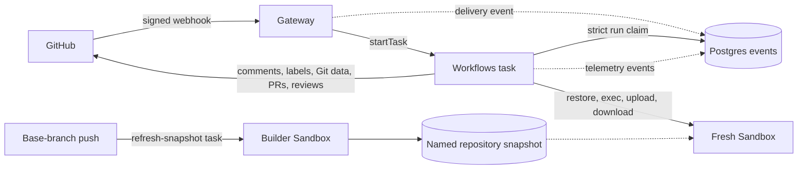

# Architecture

This document maps the repository, traces the factory's core execution paths,
and describes the interfaces between GitHub, the gateway, Render Workflows,
Postgres, Sandboxes, agents, and publishing. For deployment use
[0_QUICKSTART.md](0_QUICKSTART.md); for supported customization use
[1_EXTENSION.md](1_EXTENSION.md).

## System overview

The Blueprint in [`render.yaml`](../render.yaml) creates three resources:

- **Gateway** (`factory-gateway`) verifies GitHub webhooks, maps each delivery
  to a Workflows task, and starts that task.
- **Workflows** (`factory-workflows`) runs the three stages, cancellation,
  snapshot refresh, agents, GitHub writes, and Sandbox lifecycle.
- **Database** (`factory-db`) stores one append-only event table. Strict
  `run.claimed` rows fence competing runs; other rows are observability.

Each stage opens a fresh Render Sandbox restored from a per-repository
snapshot. The agent and model-directed tools run beside the checkout in that
Sandbox. Trusted workflow code retains GitHub authority, validates the
Sandbox's output, and performs every write.



There is no custom queue, dispatcher, heartbeat loop, maintenance service, or
cron job. Workflows owns task state and timeouts. GitHub holds the human
conversation and artifacts. Postgres is authoritative only for ordering runs
on the same issue or PR.

## Directory overview

```text
factory.config.ts             Repositories, labels, permissions, models, publish and repair limits, Sandbox timeout
render.yaml                   Blueprint for gateway, Workflows, and Postgres
.env.example                  Local environment reference
AGENTS.md                     Repository instructions for coding agents
docs/
  0_QUICKSTART.md             Deploy, use, develop, and operate
  1_EXTENSION.md              Repositories, models, agents, stages, triggers, environment
  2_ARCHITECTURE.md           Repository map, execution paths, interfaces, trust boundaries
  3_TAKEAWAYS.md              Reusable architecture and agent patterns
app/
  entrypoints/
    gateway.ts                Gateway process entry point
    workflows.ts              Workflows process entry point and task registration
  config/
    index.ts                  Config import, RepoContext, task names, model resolution
  schemas/                  Zod schemas for task inputs and agent outputs
  gateway/
    index.ts                  Hono webhook application
    signature.ts, body.ts     Constant-time signature check and body limit
    routes.ts                 Pure GitHub event-to-task routing table
  workflows/
    triage/                   Triage, thread loading, spec drafting and revision
    spec-to-pr/               Approval, implementation, verify/repair, publishing
    pr-review/                Checkout, verify, PR review, review posting
    cancel.ts                 Fence and cancel the current run
    refresh-snapshot.ts       Build a repository's named snapshot
  runs/
    with-run.ts               Permission, claim, takeover, checkpoints, status
    status.ts                 Status comment markers and working label
  agents/
    define.ts                 Typed agent definitions and prompt loading
    run.ts                    Run one agent in a stage Sandbox
    <agent>/                  One prompt.md and index.ts per built-in agent
  runner/
    main.ts, session.ts       Model loop inside the Sandbox
    protocol.ts               Runner input, tools, events, errors, usage
    tools.ts                  Read, list, shell, edit, and write implementations
    submit.ts                 JSON Schema submission validation
    keys.ts                   Provider-key mapping and credential removal
    bundle.ts                 Self-contained Sandbox runner build
  sandbox/
    client.ts                 Paced, retrying Render Sandbox API client
    snapshot.ts               Build, verify, name, and prune snapshots
    sandbox.ts                Restore, verify, fetch a ref, reinstall, terminate
    types.ts                  Sandbox, ref, and manifest contracts
  github/
    auth.ts                   App JWT and installation tokens
    client.ts                 Issues, PRs, labels, comments, reviews, permissions
    markers.ts                Hidden marker schemas and trusted lookup
    git-data.ts               Blob, tree, commit, and ref operations
  changeset/
    changes.ts                Validate collected paths, modes, blobs, and limits
    index.ts                  Rebuild and compare the GitHub tree, then move the branch
  events/
    index.ts                  Strict claims, current-run checks, best-effort events
    types.ts                  Event contracts
  format/                     Bound and sanitize model text for GitHub
  sql/                        Append-only event table migrations
sandbox/
  install-tools.sh            Add missing tools to the Debian base image
  as-runner.sh                Drop privilege and clear the environment
  run-agent.sh                Deliver the model key and run one agent
  collect-changes.sh          Stage and serialize the candidate tree
  verify.sh                   Check layout, permissions, credentials, process hardening
  build/                      Staged Git credential helper and scrubber
scripts/                      App setup, GitHub setup, doctor, migrations
tests/                        Unit and boundary tests with fakes
```

Dependencies point from process entry points toward small leaf modules. Two
boundaries are especially important:

- `app/runner/` does not import the rest of `app/`; esbuild can bundle it into
  a self-contained program for the Sandbox.
- `app/gateway/` does not import GitHub auth, Sandboxes, agents, publishing,
  or workflows. The gateway has no GitHub credential and runs no model.

## Core execution paths

### 1. Authenticate and route a delivery

`POST /webhooks/github` in
[`app/gateway/index.ts`](../app/gateway/index.ts):

1. reads at most 256 KB;
2. verifies `x-hub-signature-256` with `GITHUB_WEBHOOK_SECRET` before parsing
   JSON;
3. records the authenticated delivery as best-effort telemetry;
4. calls the pure `route(event, payload, deliveryId)` function;
5. validates the selected task input with Zod; and
6. calls `startTask("<workflow-slug>/<task>", [input])` with the delivery ID
   as the idempotency key.

The gateway returns `202` with the task run ID. A start failure returns `502`
so GitHub records a failed delivery that an operator can redeliver.

The built-in routing table is:

| GitHub delivery | Condition | Task | Idempotency key |
|---|---|---|---|
| `issues.labeled` | Triage label on an issue | `triage` | Delivery ID |
| `issue_comment.created` | Human reply on an issue with Triage label | `triage` | Delivery ID |
| `issues.labeled` | Spec-approved label on an issue | `spec-to-pr` | Delivery ID |
| `pull_request.labeled` | Review label on an open PR | `pr-review` | Delivery ID |
| `issue_comment.created` | First line is `<commandPrefix> cancel` | `cancel` | Delivery ID |
| `push` | Configured base branch | `refresh-snapshot` | `owner/name@sha` |

The router ignores unconfigured repositories, deliveries without an App
installation, irrelevant actions and labels, and bot-generated labels or
comments. Pushes remain eligible because the App is the normal source of
factory-published commits.

The task input carries repository, App installation, actor, issue or PR, and
commit from the authenticated webhook. None of those destinations comes from
model output.

### 2. Establish one current stage run

Triage, Spec-to-PR, and PR Reviewer parse their Zod input, resolve a
`RepoContext`, identify their issue or PR, and call `withRun` in
[`app/runs/with-run.ts`](../app/runs/with-run.ts).

`withRun`:

1. emits `run.started`;
2. checks the triggering actor's current GitHub permission against
   `minimumPermission`;
3. strictly appends `run.claimed` to Postgres and keeps its monotonic event ID
   as a fencing token;
4. reads the App-authored status marker, cancels the previous task when it is
   still active, updates the status, and applies `factory:working`;
5. exposes `checkpoint()` and `progress()` to the body;
6. refuses further work when a newer claim exists;
7. finalizes the status comment and working label; and
8. emits `run.finished` with outcome and duration.

Progress updates and durable writes are ownership checkpoints. A run replaced
by a relabel can finish an in-flight model call, but it cannot remain current
and publish afterwards.

An expected `RunError` is safe to show on GitHub and lets the task complete
with a failed stage outcome. Any other error produces a generic public
message containing the run ID, emits a bounded diagnostic, and fails the
Workflows task.

The `cancel` task checks permission, appends its own claim first to fence the
stage, then cancels the task ID from the status marker. Snapshot refresh does
not claim an issue or PR.

No stage automatically retries. A retry could repeat model spend and durable
work; a person relabels to start a fresh run.

### 3. Build and refresh a repository snapshot

A base-branch push starts `refresh-snapshot`. If a stage cannot find an
available snapshot, it builds one inline once. Both paths call
`buildSnapshot` in [`app/sandbox/snapshot.ts`](../app/sandbox/snapshot.ts):

1. create an allow-all builder Sandbox with a one-hour provider timeout;
2. upload runtime scripts and a freshly bundled `runner.mjs`;
3. add ripgrep to the Debian base image (which runs as root and ships Node,
   git, and `setpriv`), create the unprivileged `factory` user, and self-test
   the runner before any repository credential arrives;
4. upload a read-only installation token as a root-only file;
5. clone the configured base branch at the exact requested commit through a
   staged credential helper;
6. scrub the token and fail if any credential trace remains;
7. give the checkout to `factory` and run the configured `install`;
8. fail if installation changes a tracked file;
9. record repository, base branch, commit, lockfile hash, install command, and
   creation time in the manifest;
10. make runtime files root-owned and read-only, verify the Sandbox, create
    the named snapshot, and keep the newest two; and
11. terminate the builder in `finally`.

The stable name is `factory-<owner>-<name>`. Keeping two snapshots covers a
restore that began while a replacement was created. A failed refresh leaves
the earlier snapshot available.

### 4. Open a stage Sandbox

`openSandbox` in
[`app/sandbox/sandbox.ts`](../app/sandbox/sandbox.ts):

1. restores the repository's newest named snapshot with allow-all egress and
   `sandbox.timeoutSeconds`;
2. waits for it to run and executes `verify.sh`;
3. refuses the Sandbox unless process hardening proves the runner is
   non-dumpable;
4. checks that the manifest belongs to the requested repository;
5. obtains a new read-only installation token and fetches the requested base
   branch or `refs/pull/<n>/head`;
6. scrubs and verifies removal of the token whether fetch succeeds or fails;
7. checks out the fetched commit detached;
8. recomputes the lockfile hash and reruns `install` when the lockfiles or
   configured command differ from the snapshot manifest; and
9. returns a narrow `Sandbox` handle.

For a pull request, the fetched head must equal the SHA from the webhook.
PR Reviewer also fetches the configured base branch for diff context.

Every stage closes its Sandbox in `finally`. The provider-side timeout handles
the gap where a Workflows process dies before cleanup.

The Sandbox API client spaces calls by one second per process by default and
retries transient `429` and `503` responses.

### 5. Run Triage

Triage opens the base branch and builds an oldest-first issue thread without
other bots' comments. The `triage` agent chooses:

- **ask:** post up to five clarifying questions;
- **draft:** invoke the spec writer and post or revise the spec; or
- **decline:** post the reason.

Specs have bounded sections for problem, goals, non-goals, numbered acceptance
criteria, approach, likely files, test plan, and risks. Validation can ask the
spec writer to redraft once.

Questions and specs are stored in GitHub comments, not a separate product
database. Their hidden markers carry structured data, round or version, and
the spec's content hash.

### 6. Run Spec-to-PR

Spec-to-PR:

1. loads the latest App-authored spec marker;
2. reads the newest spec-approved label event from the issue timeline;
3. refuses a spec edited after that approval;
4. opens the base-branch Sandbox;
5. runs the implementer;
6. runs configured `verify` commands and permits up to
   `limits.repairRounds` implementer repairs;
7. collects the candidate tree in the Sandbox;
8. validates and publishes it from the trusted Workflows host; and
9. creates or finds the draft PR.

The branch is deterministically `factory/issue-<number>`. An agent cannot
choose it or a GitHub destination.

### 7. Run PR Reviewer

PR Reviewer opens the exact PR head with the base branch available, runs
configured verification, then runs one read-only `pr-reviewer` agent covering
security, correctness, performance, and tests. The agent receives no edit or
write tools and returns the final bounded review contract. Trusted code limits
inline comments to changed lines and posts one `COMMENT` review on the labeled
head SHA.

The GitHub client does not expose approve, request-changes, ready-for-review,
or merge operations.

### 8. Run an agent

`defineAgent` reads a Markdown prompt and binds it to a model tier, tool list,
turn limit, thinking level, and Zod output schema.

`runAgent` resolves the tier to `provider/model`, pairs the verbatim prompt
with the stage's task message in one `RunnerInput`, and uploads it with the provider key to a root-only
run directory in the stage Sandbox. The whole agent loop runs there; the
Workflows task only uploads input, waits, and downloads events. Then
`run-agent.sh`:

1. reads and deletes the key file as root;
2. hands the run directory to the unprivileged user;
3. starts the execute-only, non-dumpable Node runner;
4. sends the key through stdin before the input;
5. writes JSONL events and exit status outside the runner-owned directory;
6. deletes temporary run files when the host finishes.

The runner removes all known provider-key variables before creating tools.
Tool subprocesses receive a minimal environment. Secrets are redacted before
events are serialized.

The model finishes by calling `submit` with the definition's JSON Schema.
The runner can return schema errors for repair, and trusted `runAgent` parses
the final value again with the authoritative Zod schema.

`agent.finished` records reported usage and cost for both successes and
failures. There is no dollar budget; `maxTurns` and the call timeout bound
each agent.

### 9. Validate and publish changes

Publishing stays in [`app/changeset/`](../app/changeset); no GitHub write token
enters the Sandbox.

1. `collect-changes.sh` uses a throwaway Git directory to stage the working
   tree against the base commit. Agent-written hooks, config, and replacement
   refs in the checkout's `.git` cannot affect collection.
2. It serializes the staged tree SHA, raw diff, path, mode, blob SHA, and
   content of every changed blob into one downloaded artifact.
3. Host code verifies every blob SHA and rejects unsafe paths,
   `.github/workflows/`, symlinks, submodules, too many files, and oversized
   files.
4. The host reads the base commit from GitHub, creates blobs and a tree
   through the Git Data API, and requires GitHub's tree SHA to equal the
   staged Sandbox tree SHA.
5. Only then does it create a commit and create or move the deterministic
   branch.
6. An existing branch moves only when it still points at the base commit or a
   prior commit made there by this App. Human commits are never overwritten.
7. The stage creates or finds the draft PR.

This turns the Sandbox into a source of proposed bytes, not authority over
Git, GitHub, or the destination.

## Core interfaces

### Repository context

[`app/config/index.ts`](../app/config/index.ts) resolves an exact configured
repository and authenticated installation into:

```typescript
interface RepoContext {
  owner: string;
  name: string;
  fullName: string;
  installationId: number;
  config: RepoConfig;
}
```

Every downstream GitHub token, Sandbox name, branch policy, install command,
and verification command derives from this context.

### Task contracts

[`app/schemas/tasks.ts`](../app/schemas/tasks.ts) defines bounded Zod
inputs for Triage, Spec-to-PR, PR Reviewer, cancel, and snapshot refresh. Each
extends the repository and installation fields. Stage-specific fields contain
only the issue or PR, actor, approval time, head SHA, or refresh SHA needed by
trusted code.

The gateway validates before start, and each task validates again on entry.

### Stage contract

`withRun` gives the body a `RunContext`:

```typescript
interface RunContext {
  gh: GitHubClient;
  repo: RepoContext;
  subject: Subject;
  traceId: string;
  runId: string;
  checkpoint(): Promise<void>;
  progress(summary: string): Promise<void>;
}
```

The body can perform stage work but cannot bypass the permission check, claim,
takeover, or final lifecycle around it.

### Agent contract

An agent definition fixes prompt, tier, tools, output schema, and turn limit.
`RunnerInput` in
[`app/runner/protocol.ts`](../app/runner/protocol.ts) carries only rendered
prompt, message, model, thinking level, tools, output schema, limits, and
Sandbox paths.

The event protocol includes lifecycle, model usage, tool calls and results,
and exactly one terminal result or error. JSONL keeps completed events
recoverable if a process is interrupted mid-line.

### Sandbox contract

Application code uses the handle in
[`app/sandbox/types.ts`](../app/sandbox/types.ts):

```typescript
interface Sandbox {
  id: string;
  exec(command: string, options?: ExecOptions): Promise<ExecResult>;
  upload(path: string, data: string | Buffer): Promise<void>;
  download(path: string, signal?: AbortSignal): Promise<Buffer>;
  close(): Promise<void>;
}
```

Snapshot manifests separate prepared state from current state. A restored
Sandbox always fetches the requested ref and checks whether dependencies need
reinstallation.

### GitHub markers

Every factory-authored status, questions, spec, and review artifact carries a
hidden marker:

```text
<!-- software-factory:<kind> <base64url JSON> -->
```

Markers are trusted only on comments or reviews written by the App's bot.
They make GitHub writes idempotent and store the structured state needed by a
later human-gated stage.

| Marker | Carries |
|---|---|
| `status` | Run ID, stage, state |
| `questions` | Question round and bounded questions |
| `spec` | Structured spec, content hash, version, writer notes |
| `review` | Reviewed head SHA |

### Event model

The append-only `events` table contains event ID, trace ID, run ID,
repository, subject, type, JSON payload, and creation time.

- `run.claimed` is strict. Failure to append or check it stops the stage.
- Delivery, run, and agent telemetry use `emit()`, which never changes
  stage behavior when it cannot write. Nothing in the application reads it
  back; query it with `render psql`.
- The greatest claim event ID for a repository and subject is current.

## State ownership

| State | Owner |
|---|---|
| Task status, timing, input, result | Render Workflows |
| Issue discussion, labels, spec, PR, review | GitHub |
| Current-run order for an issue or PR | Newest Postgres `run.claimed` ID |
| User-visible current run | App-authored status marker and working label |
| Snapshot filesystem and manifest | Render Sandboxes |
| Delivery, run, agent, and cost history | Postgres events |

The design avoids a second product database for GitHub artifacts and avoids
rebuilding task state in Postgres.

## Trust boundaries

The factory assumes issue text, comments, repository files, dependency
scripts, and PR diffs can be adversarial.

### Gateway

The gateway holds a webhook secret, Render API key, and database URL. It has no GitHub credential and runs no repository code or model.
Signature verification happens before JSON parsing or event writes.

### Workflows host

The Workflows service holds the Render API key, GitHub App private key, model
key, and database URL. Trusted stage code selects repositories, refs, and
destinations, validates model and Sandbox output, enforces ownership, and
performs GitHub writes. No agent runs here.

### Builder Sandbox

The builder has allow-all egress and a read-only repository token only during
clone. Runtime installation and self-test happen before the token arrives.
The token is scrubbed before repository dependency installation.

### Stage Sandbox

The restored Sandbox has the checkout and allow-all egress. A read-only token
appears only during fetch and is scrubbed before agents or verification.
Agents and repository commands run as the unprivileged `factory` user. Runtime files are root-owned and read-only.

The model key enters a root-only directory for an agent call, is deleted
before privilege drops, and travels to the runner over stdin. The runner
removes key variables, tools get a minimal environment, and an execute-only
Node binary makes the runner non-dumpable. `verify.sh` must prove the expected
layout and process protection before a key is supplied.

### Publishing boundary

Sandbox output is an untrusted proposed tree. Host code validates paths,
modes, sizes, blob hashes, branch ownership, and GitHub's independently built
tree SHA before moving a ref. The Sandbox never receives a write token.

### Security invariants

1. Verify a webhook signature before parsing its body.
2. Check the triggering actor's live permission before stage work.
3. Keep GitHub writes in trusted workflow code and make them marker-idempotent.
4. Never put a write credential in a Sandbox.
5. Run tools only in a Sandbox.
6. Never let models select repositories, refs, or write targets.
7. Publish only when GitHub reproduces the validated Sandbox tree.
8. End automation at a draft PR and a COMMENT review.
9. Implement the spec that existed at approval time.
10. Give every Sandbox a provider timeout and close it in `finally`.
11. Use Postgres strictly only for cross-task ownership; keep telemetry out
    of control flow.

Tests pin these boundaries, including every built-in agent's model and tools.

### Residual risks

- **Allow-all egress:** dependency installation and Git fetches require
  network access. Malicious repository or PR code can exfiltrate checkout
  content and may attack a model key while an agent is active.
- **Model key in process memory:** non-dumpability protects it from ordinary
  same-user processes, not kernel vulnerabilities or model-directed
  exfiltration. Use a dedicated provider-capped key.
- **DNS:** DNS remains an exfiltration channel even if finer egress controls
  become available.
- **Authorized spend:** anyone with `minimumPermission` can start work. Only
  turn limits, timeouts, and the provider's spend limit bound its cost.
- **Fork PR execution:** PR Reviewer fetches and verifies fork code. A
  permitted collaborator decides whether to label it.
- **Prompt injection:** issue text, comments, source, and diffs reach models.
  Human gates and authority separation limit effects, but generated specs,
  code, and reviews still require human judgment.
- **Workspace-wide Render key:** both services hold a key that may reach more
  than this application. Use a dedicated Render workspace when isolation
  matters.
- **Postgres availability:** stages fail closed when they cannot establish or
  recheck current ownership.
- **Dashboard visibility:** Workflows inputs and results are visible to users
  with access to the Render service.

The rationale and reusable patterns behind these choices are summarized in
[3_TAKEAWAYS.md](3_TAKEAWAYS.md).
