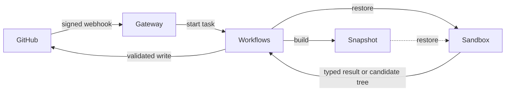

# Architecture

Agents inspect and modify repositories inside short-lived Render Sandboxes.
Code in the Workflows service validates their results and performs every
GitHub write.

## System



The Blueprint deploys two services:

- **Gateway** verifies webhooks and maps each delivery to one task.
- **Workflows** runs tasks, manages Sandboxes, and writes to GitHub.

The application does not implement its own queue, dispatcher, heartbeat
process, maintenance loop, or database.

## Workflow

```text
issue --factory:triage--> specification
specification --factory:spec-approved--> draft pull request
pull request --factory:pr-review--> COMMENT review
```

### Triage

Triage reads the issue discussion and the base branch. The triage agent asks
up to five questions, declines the request, or sends it to the spec-writing
agent. The spec-writing agent produces a bounded specification. Questions and
specifications are GitHub comments with hidden markers.

### Spec-to-PR

Spec-to-PR confirms that the approved specification has not changed. It
implements that specification in a Sandbox, runs the configured verification
commands, allows a bounded number of repairs, and opens a draft pull request
on `factory/issue-<number>`.

### PR Reviewer

PR Reviewer checks out the labeled pull request commit, runs the configured
verification commands, and posts one COMMENT review. The review covers
security, correctness, performance, and tests.

### Autopilot

Applying `factory:autopilot` grants upfront approval for Triage, Spec-to-PR, and PR Reviewer.
The parent starts each GitHub task with `ctx.run`, so every stage has its own compute, claim,
status, and Sandbox.

Autopilot does not apply the manual transition labels. Triage can still remove
a stale `factory:spec-approved` label when it revises a spec. Triage returns
the exact App-authored spec comment and content hash to Spec-to-PR, which
verifies that the current spec still matches. Spec-to-PR returns the pull
request number and head commit directly to PR Reviewer. If Triage asks
questions, the parent adds `factory:autopilot` back before it ends; a human
reply starts a new parent run. At other times the trigger label is absent, so
unrelated comments do not restart the workflow.

## State

Each system owns the state it already manages:

| State | Owner |
|---|---|
| Task status, timing, input, and result | Render Workflows |
| Issues, labels, specifications, pull requests, and reviews | GitHub |
| Current run and Sandbox for an issue or pull request | App-authored status comment |
| Prepared repository filesystem | Render Sandbox snapshot |
| Run and agent outcomes, usage, and cost | JSON lines in Workflows logs |

Telemetry is not application state. Nothing reads log events to decide what a
task may do.

## Coordination

Webhook delivery is not exactly once. GitHub can redeliver events, and people
can apply labels or post comments at the same time. The factory handles this
at three boundaries:

1. The GitHub delivery ID becomes the Workflows idempotency key.
2. The status comment names the run that holds the claim on an issue or pull
   request.
3. Hidden markers identify App-authored specifications, pull requests, and
   reviews so writes can update or reuse them.

For a composed workflow, the status marker records both the root workflow run
and the current child task. Cancellation stops the root; the child ID still
identifies the current stage and Sandbox.

A new GitHub task run cancels the run named in the status comment, terminates
its recorded Sandbox, and writes its own run ID to the comment. The run whose
write remains visible holds the claim. Other runs stop when they next check
the comment.

GitHub tasks check ownership before progress updates and durable writes.
Publishing also uses a deterministic branch and refuses to overwrite human
commits.

This design keeps coordination beside the GitHub object it controls. Adding a
database would create a second owner for the same claim.

## Sandboxes and snapshots

A base-branch push builds a repository snapshot with the runner, a base
checkout, and installed dependencies. A GitHub task then:

1. restores the newest snapshot;
2. replaces the snapshot's runner bundle with this deployment's when their
   hashes differ, root-owned and read-only to the runner user;
3. verifies runtime permissions and process hardening;
4. fetches the exact requested ref with a temporary read-only token;
5. removes the token and verifies its removal;
6. reinstalls dependencies when the lockfiles or install command changed;
7. runs agents and repository commands as an unprivileged user; and
8. closes the Sandbox in `finally`.

Render terminates a cancelled task without running `finally`. For that case,
each GitHub task records its Sandbox ID in the status comment. A replacement
run or `/factory cancel` terminates the recorded Sandbox. The provider timeout
is the final cleanup backstop.

Snapshots avoid reinstalling dependencies on every run. Restored Sandboxes
still fetch the requested commit and verify their current state; a snapshot is
prepared state, not trusted current state.

## Agents

An agent definition fixes:

- its prompt;
- its harness: the agent library and model that run it;
- available tools;
- output schema;
- turn limit; and
- stable ID.

The model loop and every model-directed tool run in the Sandbox beside the
checkout. Agent tools never run on the Workflows host.

A harness adapter in `app/harness/` wraps an agent library's own
configuration. Agent definitions and their harnesses are bundled into the
Sandbox runner, which runs the agent named in its input on that agent's
harness. The host and the runner speak a versioned contract
(`app/runner/core/protocol.ts`): JSON on stdin, with the key on the first line,
and JSON Lines events on stdout. Every harness gives the model the factory's
own tools and `submit`, so tool authority and the read-only shell policy don't
depend on the library.

A harness can declare files and a root setup command it needs in the Sandbox,
such as the pydantic adapter's Python environment. The Sandbox applies them
root-owned and read-only to the runner user before the runner self-tests, so
an agent's tools can't change the harness code another agent runs.

Every agent finishes through a typed `submit` tool. The runner validates the
submission against JSON Schema. The host validates it again with the agent's
Zod schema. Repositories, refs, issue numbers, pull requests, branches, and
write targets come from authenticated task input, never model output.

## Publishing

The Sandbox has no GitHub write credential. It returns a candidate tree to
the Workflows host, which:

1. collects changes through a throwaway Git directory;
2. validates paths, modes, file counts, sizes, and blob hashes;
3. rejects workflow files, symlinks, and submodules;
4. asks GitHub to build the same tree;
5. compares GitHub's tree SHA with the Sandbox tree SHA; and
6. moves the deterministic branch only when the factory still owns it.

## Trust boundaries

Issue text, comments, source files, dependency scripts, and pull request diffs
are untrusted.

### Gateway

The gateway verifies the webhook signature before parsing the body. It holds
no GitHub credential and runs no model or repository code.

### Workflows host

The Workflows service holds GitHub and Render credentials. It selects every
destination, checks claim ownership, validates Sandbox output, and performs
GitHub writes.

### Sandbox

Clone and fetch credentials are read-only and temporary. Runtime files are
root-owned and read-only. Agents and repository commands run as an
unprivileged user.

The model key enters the Sandbox during an agent call. The runner receives it
through a root-only path and stdin, removes provider keys from tool
environments, and runs under a non-dumpable Node binary. The pydantic harness
passes the key to its Python process on stdin; that process makes itself
non-dumpable before reading it, and its MCP tool server gets an environment
without it. These controls reduce
exposure; they do not make untrusted code safe.

## Security invariants

Changes must preserve these properties:

1. Verify a webhook signature before parsing its body.
2. Check the triggering actor's current repository permission for every
   GitHub task run.
3. Let only code in the Workflows service write to GitHub.
4. Keep GitHub write credentials out of Sandboxes.
5. Run every model-directed tool inside a Sandbox.
6. Build repositories, refs, branches, and write targets from trusted input.
7. Publish only after GitHub reproduces the validated tree SHA.
8. Stop automation at a draft pull request and a COMMENT review.
9. Implement the specification as it existed when approved.
10. Give every Sandbox a provider timeout and `finally` cleanup. Record a
    GitHub task's Sandbox so cancellation can terminate it.

Tests pin these invariants and the tool authority of every built-in agent.

## Residual risks

- Sandboxes use allow-all egress.
- The model key exists in runner memory during a call. A Cursor key also
  authorizes Cursor cloud agents and team billing.
- The Cursor harness keeps its conversation store in the Sandbox's scratch
  directory, which the agent's own tools can write.
- Prompt injection can influence specifications, code, and reviews.
- Anyone with `minimumPermission` can start model spend.
- PR Reviewer runs repository-defined commands from the labeled pull request.
- The Render API key may have workspace-wide authority.
- Near-simultaneous triggers can both work until one loses the status-comment
  claim.
- Workflows inputs and results are visible to people with service access.
- Telemetry can include repository names, issue subjects, and errors that
  quote repository output.
- The filesystem of each deployed Render service is ephemeral. Durable state
  belongs in GitHub, Workflows, or Sandbox snapshots.
- A cancelled snapshot build can leave its builder Sandbox running until the
  one-hour provider timeout because builders are not recorded in a status
  comment.

Use a dedicated Render workspace and a spend-capped model key when stronger
isolation matters.

Expected work failures produce a useful status-comment result. Unexpected
platform or programming failures fail the Workflows task and require
operator investigation.

## Code map

Start with:

1. [`app/gateway/routes.ts`](../app/gateway/routes.ts) — webhook-to-task
   routing.
2. [`app/workflows/github-task.ts`](../app/workflows/github-task.ts) —
   GitHub task declaration.
3. [`app/claims/claim.ts`](../app/claims/claim.ts) — permission, ownership,
   progress, and completion.
4. [`app/workflows/triage/index.ts`](../app/workflows/triage/index.ts) — one
   complete GitHub task.
5. [`app/workflows/autopilot/index.ts`](../app/workflows/autopilot/index.ts) —
   parent/subtask orchestration.
6. [`app/agents/run.ts`](../app/agents/run.ts) — host-side agent execution.
7. [`app/runner/main.ts`](../app/runner/main.ts) — Sandbox runner entry point;
   [`app/harness/`](../app/harness/) — agent library adapters.
8. [`app/sandbox/sandbox.ts`](../app/sandbox/sandbox.ts) — Sandbox lifecycle.
9. [`app/changeset/index.ts`](../app/changeset/index.ts) — validated
   publishing.

Use the [extension runbook](runbooks/extend.md) to add agents, tasks, or
triggers.
