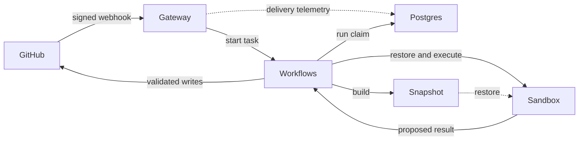

# Architecture

Software Factory separates model-directed work from authority. Agents inspect
and modify code inside short-lived Render Sandboxes; trusted Workflows code
decides what may be written to GitHub.

## System



The Blueprint creates three persistent resources:

- **Gateway** verifies GitHub webhooks and maps each delivery to one task.
- **Workflows** runs stages, agents, cancellation, snapshot refresh, and
  GitHub publishing.
- **Postgres** orders competing runs and stores best-effort telemetry.

Each stage receives a fresh Sandbox restored from a repository snapshot.
Render Workflows owns task state and timeouts. GitHub owns the human
conversation and artifacts. The application has no custom queue, dispatcher,
heartbeat loop, or maintenance cron.

## Human-gated flow

```text
issue --factory:triage--> specification
specification --factory:spec-approved--> verified draft PR
pull request --factory:pr-review--> COMMENT review
```

The stages never chain automatically. The factory cannot approve, request
changes, mark ready, or merge.

### Triage

Triage reads the issue discussion and base branch, then asks up to five
questions, writes a bounded specification, or declines. Questions and specs
are GitHub comments with hidden structured markers.

### Spec-to-PR

Spec-to-PR verifies that the specification has not changed since approval,
implements it in a Sandbox, runs configured checks, permits bounded repair
attempts, and opens a draft pull request on
`factory/issue-<number>`.

### PR Reviewer

PR Reviewer checks out the labeled head commit, runs configured verification,
and posts one COMMENT review covering security, correctness, performance, and
tests.

## State ownership

| State | Owner |
|---|---|
| Task status, timing, input, and result | Render Workflows |
| Issues, labels, specifications, PRs, and reviews | GitHub |
| Current run for an issue or PR | Latest Postgres `run.claimed` event |
| User-visible run status | App-authored GitHub marker and working label |
| Prepared repository filesystem | Render Sandbox snapshot |
| Delivery, run, agent, and cost history | Postgres events |

Only `run.claimed` is control state in Postgres. Failure to append or check a
claim stops a stage. Other events are best-effort telemetry and never drive
stage behavior.

## Idempotency and competing runs

The system handles retries and overlap at three levels:

1. GitHub's delivery ID is the Workflows idempotency key.
2. The newest append-only `run.claimed` event is a fencing token.
3. App-authored markers let writes update or reuse existing artifacts.

A replaced task may finish an in-flight model call, but it rechecks ownership
before progress updates and durable writes. Publishing also uses a
deterministic branch and refuses to overwrite human commits.

## Sandbox lifecycle

A base-branch push builds a repository snapshot containing runtime tools, a
base checkout, and installed dependencies. Every stage:

1. restores the newest snapshot;
2. verifies its permissions and process hardening;
3. fetches the exact requested ref with a temporary read-only token;
4. removes and verifies removal of that token;
5. reinstalls dependencies if lockfiles or the install command changed;
6. runs agents and repository commands as an unprivileged user; and
7. closes the Sandbox in `finally`.

The provider-side timeout is a backstop if the Workflows process dies before
cleanup.

## Agent contract

An agent definition fixes its prompt, model tier, tools, output schema, turn
limit, and optional thinking level. The complete model loop and every
model-directed tool run inside the Sandbox.

Agents finish through a typed `submit` tool. The Sandbox validates the
submission against JSON Schema, and the host validates it again with the
authoritative Zod schema. Repositories, refs, issue numbers, pull requests,
and write destinations come from authenticated task input—not model output.

## Publishing boundary

The Sandbox has no GitHub write credential. It produces a candidate tree,
which trusted Workflows code validates before publishing:

1. collect changes through a throwaway Git directory;
2. validate paths, modes, file counts, sizes, and blob hashes;
3. reject workflow files, symlinks, and submodules;
4. ask GitHub to build the same tree independently;
5. require GitHub's tree SHA to match the Sandbox tree SHA; and
6. move the deterministic branch only when ownership is safe.

This makes the model a source of proposed bytes, not authority over GitHub.

## Trust boundaries

The factory treats issue text, comments, source files, dependency scripts,
and pull request diffs as untrusted.

### Gateway

The gateway verifies the webhook signature before parsing JSON. It holds no
GitHub credential and runs no model or repository code.

### Workflows host

The Workflows service holds service credentials. Trusted code selects
destinations, enforces run ownership, validates Sandbox output, and performs
GitHub writes. No agent tool runs in this process.

### Sandboxes

Clone and fetch use temporary read-only credentials that are removed before
repository code or agents run. Runtime files are root-owned and read-only.
Agents and repository commands run unprivileged.

The model key enters the Sandbox for an agent call. It is delivered through a
root-only path and stdin, removed from the environment before tools run, and
protected by a non-dumpable runner. These controls reduce exposure but do not
eliminate it.

## Security invariants

Changes must preserve these properties:

1. Verify webhook signatures before parsing.
2. Check the triggering actor's live permission for every run.
3. Keep GitHub write credentials out of Sandboxes.
4. Run all model-directed tools inside Sandboxes.
5. Reconstruct repositories, refs, branches, and write targets from trusted input.
6. Publish only after GitHub reproduces the validated tree SHA.
7. End automation at a draft PR and COMMENT review.
8. Implement the exact specification that was approved.
9. Put a timeout and `finally` cleanup around every Sandbox.
10. Use Postgres only for cross-task ownership, never as a copy of GitHub state.

Tests pin these invariants and each built-in agent's tool authority.

## Residual risks

- Sandboxes use allow-all egress, leaving network and DNS exfiltration paths.
- The model key exists in runner memory during a call.
- Any collaborator with `minimumPermission` can initiate model spend.
- PR Reviewer executes configured verification against the labeled PR code.
- Prompt injection can influence specs, code, and reviews.
- The Render API key may have workspace-wide authority.
- Stages cannot proceed safely while Postgres ownership checks are unavailable.
- Workflows inputs and results are visible to users with access to the service.

Use a dedicated Render workspace and spend-capped model key when stronger
isolation is required.

## Code map

Start with these files:

1. [`app/gateway/routes.ts`](../app/gateway/routes.ts) — event routing.
2. [`app/runs/with-run.ts`](../app/runs/with-run.ts) — shared run lifecycle.
3. [`app/workflows/triage/index.ts`](../app/workflows/triage/index.ts) — one complete stage.
4. [`app/agents/run.ts`](../app/agents/run.ts) — Sandbox agent execution.
5. [`app/sandbox/sandbox.ts`](../app/sandbox/sandbox.ts) — Sandbox lifecycle.
6. [`app/workflows/spec-to-pr/index.ts`](../app/workflows/spec-to-pr/index.ts) — implementation and verification.
7. [`app/changeset/index.ts`](../app/changeset/index.ts) — validated publishing.

See [Contributing](../CONTRIBUTING.md) for local development and extension
recipes.
