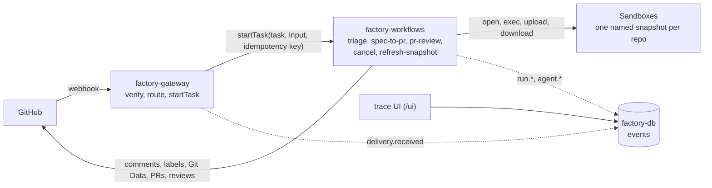

# Architecture

software-factory is three Render resources and the Sandboxes they open. Render Workflows owns run state, GitHub holds the conversation, and Postgres records what happened. The reasoning behind this shape is in [redesign.md](redesign.md).

| Resource | Type | Entry point | Holds |
|---|---|---|---|
| `factory-gateway` | Web Service | `app/src/server.ts` | Webhook secret, admin token, Render API key, database URL |
| `factory-workflows` | Workflows | `app/src/workflows.ts` | Render API key, GitHub App credentials, model key, database URL |
| `factory-db` | Postgres | `app/sql/` | The `events` table |

The gateway holds no GitHub credential and runs no model. Only the Workflows service writes to GitHub.

## How a delivery becomes a run

1. **Verify.** `POST /webhooks/github` reads the body with a 256 KB cap and checks `x-hub-signature-256` against `GITHUB_WEBHOOK_SECRET` before parsing anything (`app/gateway/index.ts`). A bad signature gets a 401 and writes nothing.
2. **Route.** `route(event, payload, deliveryId)` in `app/gateway/routes.ts` is a pure function that maps a delivery to one task and its input, or to a reason to ignore it. It ignores repositories missing from `factory.config.ts`, deliveries without an App installation, and comments or labels from bots (pushes excepted).

   | Event | Condition | Task | Idempotency key |
   |---|---|---|---|
   | `issues.labeled` | `labels.triage` on an issue | `triage` | delivery ID |
   | `issues.labeled` | `labels.specApproved` on an issue | `spec-to-pr` | delivery ID |
   | `pull_request.labeled` | `labels.prReview` on an open PR | `pr-review` | delivery ID |
   | `issue_comment.created` | First line is `/factory cancel` | `cancel` | delivery ID |
   | `issue_comment.created` | On an issue that has `labels.triage` | `triage` (with `commentId`) | delivery ID |
   | `push` | To a configured repository's base branch | `refresh-snapshot` | `owner/name@sha` |

3. **Start.** The gateway validates the input against the task's Zod schema (`app/contracts/tasks.ts`) and calls `startTask("<RENDER_WORKFLOW_SLUG>/<task>", [input], { idempotencyKey })`. A redelivered webhook returns the run the first delivery started. Idempotency keys last 24 hours and are scoped to one workflow version, so a delivery replayed across a deploy can start twice. Every GitHub write is marker-idempotent for that reason. The gateway answers 202 with the run ID, or 502 if the start failed, so the delivery shows as failed in GitHub and can be redelivered.
4. **Run the phase.** Each phase task (`app/workflows/{triage,spec-to-pr,pr-review}/index.ts`) parses its input, resolves the repository into a `RepoContext` (`app/config/index.ts`), and calls `withPhase`.
5. **`withPhase`** (`app/phases/with-phase.ts`) is the lifecycle every phase shares:
   - emits `run.started`;
   - checks the actor's live repository permission against `minimumPermission`, and stops with a `rejected` status if it falls short;
   - takes over the issue or PR: reads the run ID from the status comment's marker, cancels that run if it's still active, records itself as running, and adds `factory:working`;
   - creates the run's `Budget` (`limits.perRunUsd`) and gives the body a `progress()` callback that updates the status comment;
   - writes the final status and emits `run.finished` with the outcome, duration, and cost. A `PhaseError` is an expected failure: its message goes on GitHub and the task succeeds. Anything else posts a generic message with the run ID and fails the task.
6. **Open a sandbox.** The phase calls `openSandbox(repo, ref)` and closes the sandbox in `finally`.
7. **Run agents.** `runAgent` runs each agent in the sandbox (agents with tools) or in the task (agents without), passing what's left of the budget.
8. **Write back.** The task posts questions, a spec, a draft PR, or a review, each carrying a hidden marker.

### The phases

| Phase | Sandbox at | Agents | Writes |
|---|---|---|---|
| `triage` | Base branch | `triage` decides ask, draft, or decline. On draft, `spec-writer` drafts or revises the spec, redrafting once if validation rejects it | A questions comment, the spec comment, or a decline comment |
| `spec-to-pr` | Base branch | `implementer`, then the repo's `verify` commands with up to `limits.repairRounds` repair runs, then `self-review` (one revision allowed) | The `factory/issue-<n>` branch through the Git Data API and a draft PR |
| `pr-review` | PR head, with the base branch fetched | `verify`, then four specialists (security, correctness, performance, tests) in parallel in the same sandbox; the sandbox closes, and the `synthesizer` merges their reports in the task | One COMMENT review on the labeled commit |

`cancel` reads the status comment's run ID and calls `cancelTaskRun`. `refresh-snapshot` rebuilds a repository's snapshot. Neither runs agents.

No phase is retried automatically. A retry would repeat agent spend; a relabel starts a fresh run instead.

## State

| What | Where |
|---|---|
| Run status, input, result, timing | Workflows task runs (Render Dashboard) |
| Conversation, labels, spec, PR, review | GitHub |
| The current run on an issue or PR | The status comment's marker |
| History for observability, cost, and evals | Postgres `events` |

### GitHub markers

Every comment the factory writes carries a hidden marker, `<!-- software-factory:<kind> <base64url JSON> -->` (`app/github/markers.ts`). Markers are trusted only on comments the App's bot wrote. A run finds its earlier writes by marker before creating anything, so a replayed task updates rather than duplicates.

| Kind | On | Carries |
|---|---|---|
| `status` | The status comment on each issue or PR | Run ID, phase, state |
| `spec` | The spec comment | The spec as JSON, its sha256, a version number, and the spec writer's notes |
| `questions` | The questions comment | The round and the questions |
| `review` | The review body | The head SHA it reviewed |

Spec-to-PR implements the spec as it stood when the approval label was applied. It reads the newest `labeled` event for `labels.specApproved` from the issue timeline and refuses if the spec comment was edited after it (`app/workflows/spec-to-pr/approval.ts`).

### Events

One append-only table (`app/sql/0001_events.sql`): `trace_id` (the phase's root task run), `run_id`, `repo`, `subject` (`issue#12` or `pr#34`), `type`, `payload`, and `created_at`. The gateway's migration (`npm run db:migrate`) runs as its pre-deploy command.

| Type | Emitted by |
|---|---|
| `delivery.received` | The gateway, for every authenticated delivery, with its outcome (started, ignored, invalid, rejected, start failed) |
| `run.started`, `run.finished` | `withPhase` and `cancel` |
| `agent.started`, `agent.finished` | `runAgent`, with model, turns, token usage, cost, and outcome |
| `eval.started`, `eval.finished` | Live evals |

`emit()` (`app/events/index.ts`) never throws and never blocks a run: a database outage loses events, not runs. Without `DATABASE_URL` it's a no-op. No workflow decision reads the table. The gateway's `/ready` check doesn't touch it either.

The trace UI (`/ui`, `/ui/traces/:traceId`, `/ui/deliveries`) and its JSON twin (`/api/traces`, `/api/traces/:traceId`) read the table. Both answer 503 until `FACTORY_ADMIN_TOKEN` is set. The UI signs in with the token and keeps a signed session cookie; the API takes `Authorization: Bearer <token>`.

## Sandboxes and snapshots

Each repository has one named snapshot, `factory-<owner>-<name>`, holding the agent runner, the runtime scripts, a clone of the base branch, and installed dependencies (`app/sandbox/snapshot.ts`).

**Building** happens in `refresh-snapshot`, on every push to the base branch, or inline the first time a run finds no snapshot. The steps are ordered by trust:

1. Upload the runtime scripts and a freshly bundled runner, install tools (`sandbox-runtime/install-tools.sh`), create the unprivileged `factory` user, and self-test the runner.
2. Upload a read-only installation token as a file, clone the base branch at the pushed commit through a credential helper, then scrub the token and fail the build if any trace remains (`sandbox-runtime/build/scrub-credentials.sh`).
3. Hand the checkout to the `factory` user and run the repository's `install` command as that user. It fails if the install changes a tracked file.
4. Write a manifest (repository, commit, lockfile hash, install command), lock `/opt/factory/app` down to root-owned and read-only, run `verify.sh`, snapshot by name, and delete all but the newest two snapshots with that name.

**Opening** (`openSandbox` in `app/sandbox/sandbox.ts`) creates a sandbox from the snapshot with `timeoutSeconds` from `factory.config.ts`, runs `verify.sh`, and refuses the sandbox unless it confirms the runner's node is non-dumpable. It then fetches the requested ref as the `factory` user with a fresh read-only token, scrubs the token again, checks out the commit, and reinstalls dependencies only if the lockfile hash or install command differs from the manifest. A stale snapshot is fine: the fetch brings it up to date.

**Closing** happens in each phase's `finally`. Every sandbox has a timeout, so Render terminates any sandbox a crashed task leaves behind. Nothing reaps.

**Network** is `allow-all`: installs and fetches need it, and early access offers only allow-all and deny-all.

The Sandbox API allows 100 requests a minute per workspace. `SandboxClient` (`app/sandbox/client.ts`) paces calls (one a second per process by default, `RENDER_API_MIN_INTERVAL_MS`) and retries 429 and 503 responses.

## Agents

An agent is a markdown prompt and a `defineAgent` call (`app/agents/`). `runAgent(agent, { message, vars }, opts)` runs it where it's called:

- **In a sandbox**, when the agent declares tools. `opts.sandbox` is required, and that's a type error otherwise. `runAgent` uploads the runner input and the model key to a root-only run directory, runs `sandbox-runtime/run-agent.sh`, which deletes the key file and passes the key to the runner (running as the `factory` user) on stdin, and downloads the runner's event stream. The tools (`read`, `ls`, `bash`, `edit`, `write`) act on the checkout. Only the implementer has `edit` and `write`.
- **In the task**, when the agent has no tools. The same runner session runs in the Workflows process with no tools at all. Only the synthesizer runs this way.

The runner (`app/runner/`) is one agent loop on the Pi agent core. Its input carries the rendered prompt and the output's JSON Schema, so a prompt change is a redeploy, never a snapshot rebuild. The agent finishes by calling a `submit` tool whose schema is the agent's Zod output schema, and `runAgent` validates the submission again. Every failure throws an `AgentError` that carries the usage so far, so the budget counts failed calls too. See [agents.md](agents.md) to add one.

## Publishing

Publishing stays on the host, so no write credential enters a sandbox (`app/publish/`).

1. `sandbox-runtime/collect-changes.sh` stages the working tree against the base commit in a throwaway git directory, so nothing the agent wrote into `.git` (hooks, config, replace refs) takes effect. It writes one file: the staged tree SHA, the raw diff, and every changed blob.
2. The host downloads that file and checks it: blob SHAs match their contents, and the change breaks no publishing rule (no `.github/workflows/` files, symlinks, submodules, or unsafe paths; at most `limits.maxChangedFiles` files of at most `limits.maxFileBytes` each).
3. The host reads the base commit from GitHub, never the sandbox, and creates blobs, a tree, and a commit through the Git Data API. If GitHub's tree SHA differs from the sandbox's, publishing stops before any ref moves.
4. The branch is created or moved to the new commit. An existing branch moves only if it points at the base commit or at a commit the factory's bot created there earlier; a branch with anyone else's commits is left alone and the run fails.
5. The task opens the draft PR, or finds the one it already opened.
