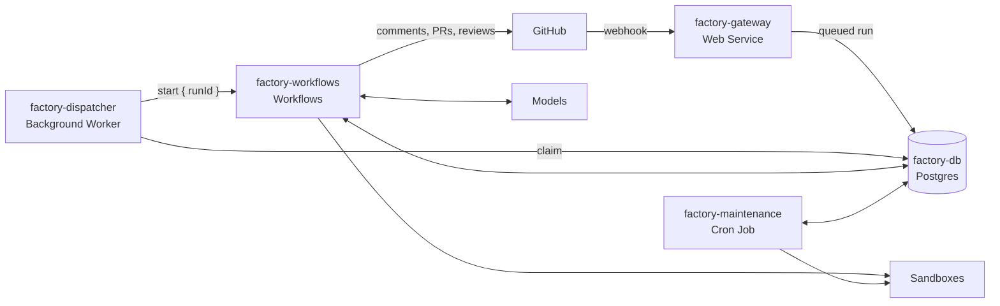

# Architecture

| Resource | Entry point |
|---|---|
| `factory-gateway` | `app/src/server.ts` |
| `factory-dispatcher` | `app/src/dispatcher.ts` |
| `factory-workflows` | `app/src/workflows.ts` |
| `factory-maintenance` | `app/src/maintenance.ts` |
| `factory-db` | `app/sql/` |

## Sandboxes
1. Maintenance builds a snapshot of the repo with dependencies installed. It rebuilds when the base branch, install command, or factory deploy changes.
2. Each run creates a fresh sandbox from the snapshot, verifies it, and fetches the ref it needs.
3. Each run terminates its sandboxes when it finishes. Maintenance reaps any that leak.

## Publishing
1. Spec-to-pr builds the commit through GitHub's Git Data API.
2. GitHub's tree SHA must match the sandbox's tree before the commit is created.
3. The branch ref must match the commit before the PR opens.

No write credential ever enters a sandbox.

## Observability
- `/ui`: run list, per-run timeline with costs, webhook deliveries.
- `/api`: `runs`, `runs/:id/events`, `runs/:id/artifacts`, `specs/:id`, `deliveries`.

Both require `FACTORY_ADMIN_TOKEN`.
