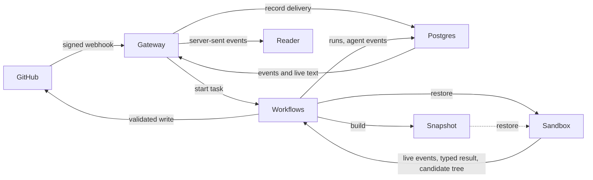

# Architecture

Agents inspect and modify repositories inside short-lived Render Sandboxes.
Code in the Workflows service validates their results and performs every
GitHub write. Postgres records every delivery, task run, and agent run, and the
gateway streams agent runs live to readers.

## Design principles

- **Agents propose. Code acts.** The model never chooses a target or holds a write credential.
- **Don’t trust agent output.** Parse, check and independently verify it before anything leaves the Sandbox.
- **Make every run safe.** Expect duplicate and overlapping triggers; one run owns a thread at any given time.
- **Limit every loop.** Bound turns, time, repairs and output; cap spend at the model provider.
- **Record outcomes as data.** Structured events per run and per agent—not model-generated explanations of what happened.

## System



The Blueprint deploys two services and a database:

- **Gateway** verifies webhooks, maps each delivery to one task from its
  payload and the thread's state in Postgres, and streams the event log to
  readers.
- **Workflows** runs tasks, manages Sandboxes, and writes to GitHub.
- **Postgres** (`factory-db`) holds an append-only event log, including every
  agent run. Both services apply its migrations at startup.

The application does not implement its own queue, dispatcher, heartbeat
process, or maintenance loop.

Work in the event log is organized around four nested units:

- **Thread** (`thread:<channel>:<id>`, such as `github:owner/name#issue-12`):
  the conversation unit (today a GitHub issue or pull request) that owns status
  and serializes work.
- **Trace**: a root workflow run and any child task runs it starts with
  `ctx.run` (for a standalone task, `traceId` equals `runId`).
- **Run** (`run:<run ID>`): one Render Workflows task execution on a thread.
- **Agent run** (`agent_run:<id>`): one model session inside a Sandbox during a
  task run.

## Workflow

```text
issue --factory:triage--> specification
specification --factory:spec-approved--> draft pull request
pull request --factory:pr-review--> COMMENT review
```

Trigger labels are commands. A run that a label started removes the label
once the run has started on its thread, so applying it again starts a new run.

A comment is a reply only while its issue waits for one. A run records whether
its thread waits for a reply when it finishes. A comment on an issue starts
work only when the root run of the issue's latest trace finished waiting, and
then it starts that root's task again: Triage waits after it asks questions or
posts a spec, and Autopilot after Triage asks. A comment on any other issue,
or while a trace is running, starts nothing.

### Triage

Triage reads the issue discussion and the base branch. The triage agent asks
up to five questions, declines the request, or sends it to the spec-writing
agent. The spec-writing agent produces a bounded specification. Questions and
specifications are GitHub comments with hidden markers.

### Spec-to-PR

Spec-to-PR confirms that the approved specification has not changed. It
implements that specification in a Sandbox, runs the configured verification
commands, allows a bounded number of repairs, and opens a draft pull request
on `factory/issue-<number>`. The draft pull request shares the issue's thread
(see [Coordination](#coordination)).

### PR Reviewer

PR Reviewer checks out the labeled pull request commit, runs the configured
verification commands, and posts one COMMENT review. The review covers
security, correctness, performance, and tests.

### Autopilot

Applying `factory:autopilot` grants upfront approval for Triage, Spec-to-PR, and PR Reviewer.
The parent starts each GitHub task with `ctx.run`, so every stage is its own run, with
its own compute, status, and Sandbox.

Autopilot does not apply the manual transition labels. Triage returns the
exact App-authored spec comment and content hash to Spec-to-PR, which verifies
that the current spec still matches. Spec-to-PR returns the pull request
number and head commit directly to PR Reviewer, which runs on the issue's
thread. If Triage asks questions, the parent finishes waiting for a reply, and
a human reply starts a new parent run that resumes Triage. A reply Triage
skips, such as a deleted comment, leaves the parent waiting.

## State

Each kind of state has one owner:

| State | Owner |
|---|---|
| Deliveries, task runs, the run that owns each thread, whether it waits for a reply, linked threads, outcomes, and Sandboxes | Postgres event log |
| Agent runs: messages, tool calls, outcome, usage, and cost | Postgres event log |
| Whether a task process is alive, and its input and result | Render Workflows |
| Issues, labels, specifications, pull requests, and reviews | GitHub |
| Prepared repository filesystem | Render Sandbox snapshot |

The status comment on an issue or pull request is a view of the thread's latest
trace, rendered from Postgres. Nothing reads it back, and nothing reads
agent run events to decide what a task may do: they are for people to watch.

### Event log

The `events` table in Postgres (`app/db/`) is append-only. Each event belongs
to a stream and takes the stream's next version. An append can require the
stream to be at an expected version, so two writers can't both act on the same
state. Payloads are validated against the types declared in `app/events/catalog.ts`.

Events about a thread also record its key (`<channel>:<id>`, such as
`github:owner/name#issue-12` or `github:owner/name#pr-34`). `app/threads/`
owns the format and each channel's key builder; the log never parses the ID,
and an append rejects a key outside the format, so every thread is namespaced
by its channel.

Projections are tables derived from the log, updated in the same transaction
as each append, and `npm run db:rebuild` replays the log to recreate them.
Listeners on the `events` channel hear of an event when its transaction
commits. Readers page one stream by version and a thread by transaction
order, so an event that commits late is never skipped.

## Coordination

Webhook delivery is not exactly once. GitHub can redeliver events, and people
can apply labels or post comments at the same time. The factory handles this
at three boundaries:

1. The gateway records each delivery in the log as the stream and idempotency
   key `delivery:github:<delivery ID>`, so another channel's delivery IDs can't
   collide with GitHub's. The bare delivery ID is the Workflows idempotency key. If Postgres is unavailable it
   returns 502, so GitHub marks the delivery failed and it can be redelivered.
2. The version of a thread's `thread:<thread>` stream fences the runs that
   start on it.
3. Hidden markers identify App-authored specifications, pull requests, and
   reviews so writes can update or reuse them.

A run starts on its thread by appending `run.started`, with its run and trace
IDs, to `thread:<thread>`. The trace whose run started last owns the thread
until all of its runs finish. Each run's progress, attached Sandbox, and end
are events on its own `run:<run ID>` stream.

A root run appends `run.started` at the `thread:<thread>` version it read. If a
concurrent run appended first, the loser rereads the new version and retries so
it displaces the new winner rather than running unfenced. If the displaced
trace still has running runs, the new run cancels that trace's root if Render
still has it active, terminates the Sandboxes those runs recorded, and appends
`run.stopped` for each. Appending `run.started` first fences the displaced
trace even when stopping it fails: it stops at its next ownership check. A
child run starts only while its own trace is the thread's latest, so a stale
child can never take the thread back.

A factory pull request shares its issue's thread. When Spec-to-PR opens or
finds its draft pull request, it appends `thread.linked`, naming the issue's
thread, to the pull request's thread stream. The gateway resolves every
delivery on a linked pull request to the issue's thread: `/factory cancel`
there stops the issue's work, and `factory:pr-review` runs PR Reviewer on the
issue's thread, taking it over like any root run. The status comment for that
work stays on the issue, and requesting the pull request's event stream serves
the issue's stream. A pull request a person opens has its own thread.

The actor's permission is checked before a run starts. A rejected run never
appends to `thread:<thread>`, so it displaces nothing. Its `run.rejected` is
recorded on `run:<run ID>`, and GitHub posts a rejection comment at most once,
only when the thread has no prior runs, so unprivileged commenters cannot
trigger repeated status comments.

`/factory cancel` is a run like any other. Starting it stops the running trace,
root and current child; its result is what it stopped, or that nothing was
running.

A run is current while its trace is the thread's latest and the run is still
running. GitHub tasks check this immediately before progress updates and
durable writes, and publishing checks it again immediately before moving the
branch. The GitHub write happens after the check, outside the transaction, so a
run can still be displaced in between. Publishing also uses a deterministic
branch and refuses to overwrite human commits. A run that fails after it was
displaced, for example because its Sandbox was terminated, ends as superseded
rather than as a failure.

Render Workflows decides whether a task process is alive. Render can cancel a
task without running its `finally`, which leaves its run recorded as running
and its trace owning the thread until another run, such as `/factory cancel`,
takes over. There is no sweeper.

The status comment and `factory:working` are synced from Postgres after each
start, progress update, and finish. The comment reflects the thread's latest
trace: if its most recently started run is still `running`, the comment shows
that run; otherwise it shows the trace's root run and how the trace ended.
`factory:working` is present while that trace has a running run. A thread
records one status comment; when two syncs create one at once, the one recorded
first stays and the other is deleted. A GitHub failure while syncing is logged
and never fails the run; the final sync retries. Editing or deleting the
comment can't change who owns the issue or pull request.

## Sandboxes and snapshots

A base-branch push builds a repository snapshot with the runner, a base
checkout, and installed dependencies. A task then:

1. restores the newest snapshot;
2. replaces the snapshot's runner bundle with this deployment's when their
   hashes differ, root-owned and read-only to the runner user;
3. verifies runtime permissions and process hardening;
4. fetches the exact requested ref with a temporary read-only token;
5. removes the token and verifies its removal;
6. reinstalls dependencies when the lockfiles or install command changed;
7. runs agents and repository commands as an unprivileged user; and
8. closes the Sandbox in `finally`.

Render terminates a cancelled task without running `finally`. For that case,
each GitHub task records its Sandbox ID in Postgres. A run that takes over the
thread, such as `/factory cancel`, terminates the recorded Sandbox. The
provider timeout is the final cleanup backstop.

Snapshots avoid reinstalling dependencies on every run. Restored Sandboxes
still fetch the requested commit and verify their current state; a snapshot is
prepared state, not trusted current state.

## Agents

An agent definition fixes:

- its prompt;
- its harness: the agent library and model that run it;
- available tools;
- output schema;
- turn limit; and
- stable ID.

The model loop and every model-directed tool run in the Sandbox beside the
checkout. Agent tools never run on the Workflows host.

A harness adapter in `app/harness/` wraps an agent library's own
configuration. Agent definitions and their harnesses are bundled into the
Sandbox runner, which runs the agent named in its input on that agent's
harness. The host and the runner speak a versioned contract
(`app/runner/core/protocol.ts`): JSON on stdin, with the key on the first line,
and JSON Lines events on stdout. Every harness gives the model the factory's
own tools and `submit`, so tool authority and the read-only shell policy don't
depend on the library. In the runner, a kernel owns each run: its events, turn
and time limits, tools, and submission. A harness's driver only translates its
library.

The built-in harness runs Pi's coding agent SDK
(`@earendil-works/pi-coding-agent`) through `createAgentSession`
(`app/runner/pi/driver.ts`). The session's working directory is the untrusted
checkout, and the runner holds the model key in memory, so the driver turns
off Pi's discovery: it loads no context file such as `AGENTS.md`, skill,
prompt template, theme, or extension from the checkout or anywhere else. The
system prompt is the agent's prompt file, and the tools are exactly the
factory's. Every model request passes the kernel's turn limit before it is
sent, including Pi's retries of transient errors and its context compaction.

Every agent finishes through a typed `submit` tool. The runner validates the
submission against JSON Schema. The host validates it again with the agent's
Zod schema. Repositories, refs, issue numbers, pull requests, branches, and
write targets come from authenticated task input, never model output.

### Agent run events

`runAgent` records every agent run in the event log as an `agent_run:<id>`
stream, whose thread is the task's issue or pull request. A recorder on the
Workflows host (`app/agent-runs/recorder.ts`) is the stream's only writer. It
translates the runner's events into `assistant.message`, `tool.call`,
`tool.result`, and `usage` events and writes them every 250 ms in one
transaction. Runner output is untrusted: it becomes display events on the
run's own stream and nothing else. `agent_run.finished`, with the outcome,
turns, usage, and cost, comes from the host's own summary of the run, and the
`agent_runs` table projects it. A database error never fails the agent run;
the recorder keeps a bounded queue and logs what it couldn't write.

The runner reports live through the host. `run-agent.sh` writes the runner's
output both to the root-owned `<runDir>.jsonl` beside the run directory and to
the command's stdout, which the host reads as it arrives and feeds to the
recorder line by line. Nothing in the Sandbox holds an endpoint or credential
for the log. If the command stream drops, the command keeps running, and the
host follows the file from the last complete line it relayed until
`run-agent.sh` exits, so no event is lost or repeated. The runner escapes
every non-ASCII character, so the byte offset the host counts from decoded
output always matches the file. When the command ends,
the host downloads the file, relays any lines the live copy missed, and takes
the result, outcome, and cost from the file alone.

The model's text as it streams travels as `NOTIFY` messages on the `live`
channel, sent in the recorder's transactions and never stored. Each gateway
instance holds one `LISTEN` connection for `events` and `live`
(`app/gateway/hub.ts`) and keeps the text so far of every in-progress message
in memory, so instances serve the same streams without sharing state. A
notification only wakes readers, which then read from their own cursors, and
readers also poll every 5 seconds, so a missed notification costs latency,
never an event. A missed delta is lost; the final message is in the log.

The gateway streams one agent run, or everything on a thread,
as server-sent events to holders of `EVENTS_READ_TOKEN` (`app/gateway/stream.ts`).
Each stream's event IDs are its log cursors: the stream version for an agent
run, and `<tx>-<seq>` for a thread. A GitHub issue or pull request also has a
path by repository, kind, and number, which the status comment shows.

## Publishing

The Sandbox has no GitHub write credential. It returns a candidate tree to
the Workflows host, which:

1. collects changes through a throwaway Git directory;
2. validates paths, modes, file counts, sizes, and blob hashes;
3. rejects workflow files, symlinks, and submodules;
4. asks GitHub to build the same tree;
5. compares GitHub's tree SHA with the Sandbox tree SHA; and
6. moves the deterministic branch only when the factory still owns it and,
   checked immediately before, the run still owns its thread.

## Trust boundaries

Issue text, comments, source files, dependency scripts, and pull request diffs
are untrusted.

### Gateway

The gateway verifies the webhook signature over the raw body bytes before
decoding or parsing them. It holds no GitHub credential and runs no model or
repository code. It holds the database credential. It serves event streams
only to requests that present `EVENTS_READ_TOKEN`, compared in constant time.

### Workflows host

The Workflows service holds GitHub, Render, and database credentials. It
selects every destination, checks thread ownership, validates Sandbox output,
and performs GitHub writes.

### Sandbox

Clone and fetch credentials are read-only and temporary. Runtime files are
root-owned and read-only. Agents and repository commands run as an
unprivileged user.

Every Sandbox is created with an HTTPS egress allow-list built by the
Workflows host from trusted configuration. Task Sandboxes reach `github.com`,
the agents' model APIs, and the repository's configured `egress` hosts. The
snapshot builder reaches `github.com`, Debian's package mirror, and the
repository's hosts. Render enforces the list outside the Sandbox and fixes it
at creation, so nothing inside the Sandbox can widen it. See
[Sandbox egress](configuration.md#sandbox-egress).

The model key enters the Sandbox during an agent call. The runner receives it
through a root-only path and stdin, removes provider keys from tool
environments, and runs under a non-dumpable Node binary. These controls and
the allow-list reduce exposure; they do not make untrusted code safe.

## Security invariants

Changes must preserve these properties:

1. Verify a webhook signature over its raw bytes before decoding or parsing
   its body.
2. Check the triggering actor's current repository permission for every
   GitHub task run before it starts on its thread.
3. Let only code in the Workflows service write to GitHub.
4. Keep GitHub write credentials out of Sandboxes.
5. Run every model-directed tool inside a Sandbox.
6. Build repositories, refs, branches, and write targets from trusted input.
7. Publish only after GitHub reproduces the validated tree SHA.
8. Stop automation at a draft pull request and a COMMENT review.
9. Implement the specification as it existed when approved.
10. Give every Sandbox a provider timeout and `finally` cleanup. Record a
    GitHub task's Sandbox in Postgres before its next ownership check, so a
    run that takes over the thread can terminate it.
11. Create every Sandbox with an egress allow-list built from trusted
    configuration. Only a repository's configured `egress: "allow-all"` lifts it.
12. Give database credentials only to the gateway and Workflows services.
    Nothing in a Sandbox holds one or writes events.
13. Treat runner output as untrusted: record it only as display events on its
    own agent run, and take outcomes and costs from the host's summary.
14. Load no repository file as a prompt, skill, prompt template, or
    extension. An agent's instructions are its prompt file and task message,
    and its tools are the factory's.

Tests pin these invariants and the tool authority of every built-in agent.

## Residual risks

- Allowed hosts remain exfiltration paths. Code in a Sandbox can send data to
  an attacker's own GitHub account or model API account through `github.com`
  or the model API, and to anything a wildcard rule admits. Task Sandboxes
  keep `github.com` for their whole lifetime because the policy can't change
  after the fetch.
- DNS resolution is not restricted by the allow-list.
- A repository configured with `egress: "allow-all"` has unrestricted egress.
- The model key exists in runner memory during a call.
- Prompt injection can influence specifications, code, and reviews.
- Anyone with `minimumPermission` can start model spend.
- PR Reviewer runs repository-defined commands from the labeled pull request.
- The Render API key may have workspace-wide authority.
- The gateway's database credential can write factory state, so a compromised
  gateway can forge events.
- Anyone with `EVENTS_READ_TOKEN` can read every agent run's messages and tool
  output, for every repository. Readers share the one token.
- A process in a Sandbox that forges runner output can change what stream
  readers see, though not what the task does or what the run cost.
- Near-simultaneous triggers can both work until one fails its next ownership
  check.
- Workflows inputs and results are visible to people with service access.
- Service logs and the event log can include repository names, issue
  titles, and errors that quote repository output.
- The filesystem of each deployed Render service is ephemeral. Durable state
  belongs in GitHub, Workflows, Postgres, or Sandbox snapshots.
- A cancelled snapshot build can leave its builder Sandbox running until the
  one-hour provider timeout because builders are not recorded.

Use a dedicated Render workspace and a spend-capped model key when stronger
isolation matters.

Expected work failures produce a useful status-comment result. Unexpected
platform or programming failures fail the Workflows task and require
operator investigation.

## Code map

Start with:

1. [`app/gateway/routes.ts`](../app/gateway/routes.ts) — webhook-to-task
   routing.
2. [`app/workflows/github-task.ts`](../app/workflows/github-task.ts) —
   GitHub task declaration.
3. [`app/runs/run.ts`](../app/runs/run.ts) — permission, starting, progress,
   and completion; [`app/runs/thread.ts`](../app/runs/thread.ts) — thread
   ownership and stopping a displaced trace;
   [`app/runs/status.ts`](../app/runs/status.ts) — the status comment view.
4. [`app/workflows/triage/index.ts`](../app/workflows/triage/index.ts) — one
   complete GitHub task.
5. [`app/workflows/autopilot/index.ts`](../app/workflows/autopilot/index.ts) —
   parent/subtask orchestration.
6. [`app/agent-runs/run.ts`](../app/agent-runs/run.ts) — host-side agent execution.
7. [`app/runner/main.ts`](../app/runner/main.ts) — Sandbox runner entry point;
   [`app/harness/`](../app/harness/) — agent library adapters.
8. [`app/sandbox/sandbox.ts`](../app/sandbox/sandbox.ts) — Sandbox lifecycle.
9. [`app/changeset/index.ts`](../app/changeset/index.ts) — validated
   publishing.
10. [`app/db/store.ts`](../app/db/store.ts) — appending to the event log;
    [`app/db/read.ts`](../app/db/read.ts) — reading it in order.
11. [`app/agent-runs/recorder.ts`](../app/agent-runs/recorder.ts) — recording an agent
    run; [`app/gateway/stream.ts`](../app/gateway/stream.ts) — streaming it.

Use the [extension runbook](runbooks/extend.md) to add agents, tasks, or
triggers.
