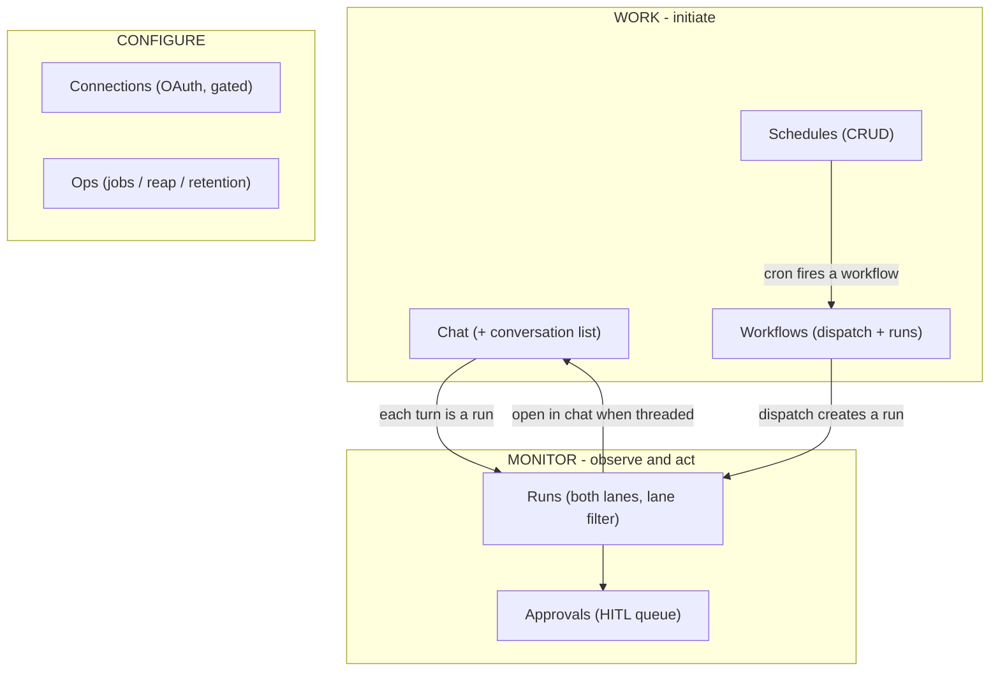

# Sprint 03-UI — Operator Console IA Redesign: intent-grouped navigation, one router, fuller surface

**Status:** PLANNED
**Wave:** Post-MVP — Operability & UX
**Depends on:** 03 (gateway HTTP + SSE), 01-Q (two-lane execution), 02-S (streaming chat)
**Unblocks:** a coherent operator mental model; surfacing schedule/workflow/connection/ops capabilities that already exist in the backend

---

## Goal

Redesign the operator web app (`packages/gateway/ui`) from first principles so navigation and information architecture match how an operator actually thinks about the platform, and surface high-value backend capabilities that currently have no UI.

Today the app is five flat, equally-weighted peers — `Runs`, `Approvals`, `Chat`, `Threads`, `Schedules` — plus a run drill-down. That IA has three problems:

1. **Overlapping doors to the same data.** A chat turn is simultaneously a message in `Chat`, a row in `Threads`, and a `Run`. Three peers expose the same underlying object, so there is no obvious source of truth.
2. **No hierarchy / no primary object.** Interaction (`Chat`), automation (`Schedules`), observation (`Runs`), and governance (`Approvals`) sit side by side with no grouping, so nothing signals "start here" or "this is where you go to watch/act."
3. **The platform is under-exposed.** The gateway already supports workflow dispatch, full schedule CRUD, OAuth connections, and admin/ops (queue depth, reap, retention) — none of which have a UI.

A fourth, concrete bug motivated the rethink: routing is hash-only with **no path canonicalization**, so landing on a non-canonical path like `/ui/approvals` yields `/ui/approvals#/approvals` and never self-corrects.

---

## Foundational decisions in play

- [D12](../specs/00-foundations.md#d12--two-execution-lanes-durable-workflows-vs-interactive-chat) — two execution lanes. The new IA makes the lanes legible: Lane A (workflows/schedules) lives under **Work → Workflows/Schedules**; Lane B (chat turns) lives under **Work → Chat**; both are observable in **Monitor → Runs** via a lane filter.
- The event log / SSE contract (03) is unchanged. This sprint is UI-only plus two small **read** endpoints (`GET /workflows`, `GET /connections`) that expose already-present state.

---

## Target information architecture

Left-rail navigation, grouped by operator intent, driven by a single section registry (`ui/src/state/sections.tsx`) that is the one source of truth for the nav, the router, the command palette, and breadcrumbs.



Primary object = the **conversation** (Chat, with the thread list merged in as a left pane). **Runs** is the cross-lane audit backbone, not a peer to Chat/Threads. Cross-links stitch the model together: Run detail → "open in chat" when a run has a `threadId`; Chat → "open trace".

---

## Design decisions

- **DUI1 — One section registry.** `sections.tsx` exports `NAV_ITEMS` (`{ id, label, group, Icon, gated? }`) and the group order. `Shell`, `CommandPalette`, and the breadcrumb all read it; `App` maps `id → view`. Adding a view touches one array plus one switch arm.
- **DUI2 — Merge Threads into Chat.** The thread list becomes a conversation-picker pane inside `ChatView`; `Threads` leaves the nav. `#/threads` redirects to `#/chat` so old links/bookmarks survive.
- **DUI3 — Runs is the single audit surface for both lanes.** A `lane` filter (All / Workflow / Chat) partitions runs by whether they carry a `threadId` (Lane B) or not (Lane A). No new endpoint — the field already exists on the run record.
- **DUI4 — Hash routing, canonicalized.** Keep hash routing (works regardless of mount, no server route table), but on boot fold any extra pathname under the SPA base into the hash and `replaceState` back to the base, fixing the `/ui/approvals` class of bug. Unknown sections render a `NotFound` instead of silently falling back to Runs.
- **DUI5 — Expose the backend, minimally.** New views (`Workflows`, `Schedules` CRUD, `Connections`, `Ops`) call existing endpoints. Two tiny read routes are added because the data exists but had no GET: `GET /workflows` (names for the dispatch/schedule pickers) and `GET /connections?userId` (provider list + per-user connected status). `Connections` is nav-gated on `GET /connections` succeeding with a non-empty provider list.

---

## Routing canonicalization

```ts
// ui/src/state/router.ts — run once before first render
const base = import.meta.env.BASE_URL.replace(/\/$/, ""); // "/ui"
const p = location.pathname;
if (p.startsWith(base) && p !== base && p !== base + "/") {
  const extra = p.slice(base.length).replace(/^\//, "");   // "approvals"
  const hash = location.hash || (extra ? `#/${extra}` : ""); // keep existing hash if present
  history.replaceState(null, "", `${base}/${hash}`);         // -> /ui/#/approvals
}
```

---

## View inventory (before → after)

- Runs → **Runs** (adds lane filter + cross-links). `ui/src/views/RunsView.tsx`
- Run detail → unchanged lenses; already links to chat. `ui/src/views/RunDetailView.tsx`
- Approvals → **Approvals** (unchanged; now under Monitor). `ui/src/views/ApprovalsView.tsx`
- Chat + Threads → **Chat** with a merged conversation-list pane. `ui/src/views/ChatView.tsx` (absorbs `ThreadsView.tsx`)
- Schedules → **Schedules** with full create/edit/delete. `ui/src/views/SchedulesView.tsx`
- (new) **Workflows** — list + dispatch + filtered runs. `ui/src/views/WorkflowsView.tsx`
- (new) **Connections** — OAuth connect/disconnect. `ui/src/views/ConnectionsView.tsx`
- (new) **Ops** — queue depth, reap, retention. `ui/src/views/OpsView.tsx`

---

## Backend additions (small, read-only)

- `GET /workflows` → `{ workflows: [{ name }], defaultWorkflow? }` from the `workflows` map in `packages/gateway/src/app.ts`.
- `GET /connections?userId=` → `{ providers: [{ provider, connected, scopes?, expiresAt? }] }`, only registered when `oauthProviders` is configured; reads `runtime.oauthStore.getConnection`.

---

## Testing

- Router unit checks: `/ui/approvals` canonicalizes to `/ui/#/approvals`; `#/threads` redirects to `#/chat`; unknown section → `NotFound`; deep links `#/runs/:id`, `#/chat/:threadId` resolve.
- Gateway: `GET /workflows` lists registered names; `GET /connections` reports per-user status and 404s when OAuth is not configured.
- Build + UI typecheck + lint; manual smoke of every view against the running gateway.

---

## Non-goals

- Agents management and Usage/cost analytics (need new backend aggregation) — deferred.
- Migration to History API path routing — hash routing is retained.
