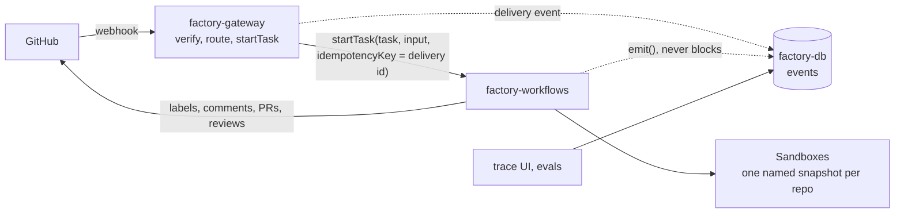

# Redesign: less machinery, more platform

Status: implemented, October 2026. Replaces the 0.1.0 architecture in [`0-1-0-spec.md`](0-1-0-spec.md). The current behavior is documented in [architecture.md](architecture.md), [security.md](security.md), and [agents.md](agents.md); where this document and the code disagree, the code and those docs win.

## Why

The 0.1.0 factory rebuilt, in Postgres and a cron, things Render Workflows and Sandboxes already do: a run queue, a dispatcher, heartbeats, lost-run recovery, advisory locks, a snapshot table, and a sandbox reaper. Most of its launch-blocking bugs live in that layer. It also ran every agent in the Workflows task and sent each tool call to the sandbox over the API, which collides with the Sandbox API's limit of 100 requests a minute per workspace.

The redesign keeps what the factory is for (labeled issue to spec to draft PR to review, with no write credential in a sandbox and no automated approvals or merges) and lets the platform carry the rest.

## Goals

- Three phases: Triage, Spec-to-PR, and PR Reviewer.
- Many repositories from one deployment.
- Three Render resources: a gateway, a Workflows service, and Postgres.
- Postgres records what happened (observability, cost, evals). No workflow decision reads it.
- Agents run either in a Workflows task (no tools) or in a sandbox (with tools), decided at the call site.
- One sandbox snapshot per repository, refreshed without a cron.

Not in scope for launch: browser-based UX testing, automatic chaining from Triage into Spec-to-PR, and approving or merging PRs (never).

## Architecture



| Resource | Type | Holds | Job |
|---|---|---|---|
| `factory-gateway` | Web Service | Webhook secret, admin token, Render API key, database URL | Verify webhooks, route them to tasks, serve the trace UI |
| `factory-workflows` | Workflows | Render API key, GitHub App, model keys, database URL | Every task: phases, agents, snapshot refresh, cancel |
| `factory-db` | Postgres | Events | Append-only record of deliveries, runs, agent turns, and costs |

There is no dispatcher and no cron job.

## Triggering

The gateway verifies the signature, maps the event to one task and its input, and calls `startTask` with the GitHub delivery ID (`X-GitHub-Delivery`) as the idempotency key. A redelivered webhook returns the run the first delivery started. Idempotency keys last 24 hours and are scoped to one workflow version, so a delivery replayed across a deploy can still start twice; GitHub writes are marker-idempotent for that reason.

| Event | Condition | Task | Input |
|---|---|---|---|
| `issues.labeled` | `factory:triage` | `triage` | `{ repo, issue, actor }` |
| `issue_comment.created` | Human reply on an issue in triage | `triage` | `{ repo, issue, actor, commentId }` |
| `issues.labeled` | `factory:spec-approved` | `spec-to-pr` | `{ repo, issue, actor, labeledAt }` |
| `pull_request.labeled` | `factory:pr-review` | `pr-review` | `{ repo, pr, headSha, actor }` |
| `issue_comment.created` | `/factory cancel` | `cancel` | `{ repo, number, actor }` |
| `push` | To a configured repo's base branch | `refresh-snapshot` | `{ repo, sha }` (idempotency key `repo@sha`) |

`repo` and the GitHub App installation (`installationId`, in every input) come from the webhook, so one App installed on several repositories serves all of them. Repositories missing from `factory.config.ts` are ignored.

The routing table is a pure function from `(event, payload)` to `(task, input) | null`, so it can be tested without a server.

### One active run per issue or PR: latest wins

Each phase posts or updates a status comment on its issue or PR. A hidden marker in that comment records the current task run ID. When a run starts, it reads the marker, calls `cancelTaskRun` on the previous run if it is still active, and writes its own ID. Relabeling an issue restarts its phase.

### Cancel

The `cancel` task reads the run ID from the status comment marker and calls `cancelTaskRun`. The gateway needs no GitHub token.

## State

| What | Where |
|---|---|
| Run status, results, retries, timing | Workflows task runs |
| Conversation, labels, spec, PR | GitHub, with hidden markers on every factory-written comment |
| Current run per issue or PR | The status comment marker |
| History for observability, cost, and evals | Postgres `events` |

### Specs live in their GitHub comment

Triage posts the spec as a comment whose hidden marker carries the spec as JSON and a content hash. Revisions edit the comment. `spec-to-pr` implements the spec comment as it stood when the approval label was applied: it reads the issue's `labeled` timeline event and refuses if the comment was edited after it.

### Events

One append-only table:

```sql
create table events (
  id         bigserial primary key,
  trace_id   text not null,          -- root task run id
  run_id     text,                   -- the task run that emitted it
  repo       text,
  subject    text,                   -- "issue#12" or "pr#34"
  type       text not null,          -- delivery.received, run.started, agent.turn, cost, run.finished, ...
  payload    jsonb not null default '{}',
  created_at timestamptz not null default now()
);
create index on events (trace_id, id);
create index on events (repo, subject, created_at desc);
```

`emit(event)` writes one row and swallows errors: a database outage loses events, never runs. Transcripts aren't stored; agent events record the model, turns, usage, cost, and outcome.

## Repositories

Configured centrally:

```ts
export default defineFactoryConfig({
  repos: {
    "acme/web": {
      baseBranch: "main",
      install: "npm ci",
      verify: ["npm run build", "npm test"],
    },
    "acme/api": {
      baseBranch: "main",
      install: "go mod download",
      verify: ["go test ./..."],
    },
  },
  labels: { triage: "factory:triage", specApproved: "factory:spec-approved", prReview: "factory:pr-review" },
  minimumPermission: "write",
  models: { small: "...", medium: "...", large: "..." },
  limits: { perRunUsd: 20 },
});
```

Each run resolves one `RepoContext` from the webhook's repository and passes it down. Nothing reads "the first repo".

## Sandboxes and snapshots

Each repository has one named snapshot, `factory-<owner>-<name>`, holding the clone at a base commit, installed dependencies, and the agent runner. `sandboxes.create({ snapshotName })` restores the newest available one.

- **Building** happens in the `refresh-snapshot` task, triggered by a push to the base branch. The steps are ordered by trust, as in [codebase-researcher](https://github.com/render-examples/codebase-researcher/blob/main/docs/sandboxes.md):
  1. Upload the runner and scripts, install tools, and self-test the runner.
  2. Upload a read-only GitHub token, clone at the pushed commit, then scrub the token and verify none remains.
  3. Install dependencies as the unprivileged runner user, with no secret present.
  4. Write a manifest (commit, lockfile hash, install command), snapshot by name, and keep the newest two.
- **Opening** (`openSandbox(repo, ref)`) restores the snapshot, fetches the ref, and reinstalls only if the lockfile hash or install command differs from the manifest. If no snapshot exists, it builds one inline once. A stale snapshot is fine: the fetch brings it up to date.
- **Closing** happens in `finally`. Every sandbox is created with `timeoutSeconds`, so Render terminates any sandbox a crashed task leaves behind. Nothing reaps.
- **Network** is `allow-all`, because installs and fetches need it. Early access supports only allow-all and deny-all, sent as `{ type }`.
- **Credentials**: a read-only token enters a sandbox only to clone or fetch, and is scrubbed before any agent or repository code runs. No write credential ever enters a sandbox.

The builder, verification, and credential-scrub code are lifted from codebase-researcher (`src/sandbox/render/`, `sandbox-runtime/`).

## Agents

### Defining an agent

An agent is a markdown prompt and a few typed lines:

```text
app/agents/
  implementer.md
  implementer.ts
```

```ts
export const implementer = defineAgent({
  id: "implementer",
  prompt: "implementer.md",
  model: "large",
  tools: ["read", "ls", "bash", "edit", "write"],
  output: Implementation,
  maxTurns: 150,
});
```

`defineAgent` resolves the prompt path and reads the file as a string. There is no frontmatter and no parsing. The prompt reaches the runner verbatim, with `{{name}}` placeholders filled from the call's variables. `output` is a Zod schema; the runner exposes it to the model as the schema of its submit tool and validates the submission.

### Running an agent

An agent runs where you call it, and its tools act there:

```ts
// In the task: no sandbox, so no tools.
const review = await runAgent(synthesizer, { message, vars: { repo } }, { traceId, budgetUsd });

// In the sandbox you pass: its tools act on that sandbox.
const implementation = await runAgent(implementer, { message, vars }, { sandbox, traceId, budgetUsd, timeoutMs });
```

- An agent that declares tools requires `{ sandbox }`; that is a type error otherwise. A Workflows task holds the factory's secrets, so tools never run there.
- `runAgent` is a function, not a task. Wrap it in `task()` when you want its own retry, timeout, and line in the Render Dashboard; call it inline when you don't. Tasks are named by hand, so names can't collide by accident. Every agent call in the phases is inline today.
- It returns `{ output, usage, costUsd, turns }` and emits `agent.started` and `agent.finished` events.
- **Budget is passed down, not looked up.** The workflow gives each call the budget remaining (`Budget.track`); the runner stops when it is spent, and the workflow subtracts the reported cost.

### The runner

In a sandbox, `runAgent` uploads the runner input (the rendered prompt, model, tools, output schema, turn, time, and budget limits, and the message) and the model key to a root-only run directory, runs the bundled runner, and downloads its events and result. The runner is codebase-researcher's pi runner with the prompt moved out of the bundle and into the input, so changing a prompt is a redeploy, never a snapshot rebuild. Its key handling carries over, with one change: `run-agent.sh` deletes the key file as root and hands the key to the runner on stdin, so it never exists as a file the runner user can read. Tool processes get a scrubbed environment, and the runner process is non-dumpable. Use a spend-capped model key; credential brokering, when Sandboxes ships it, would keep the key out of the sandbox entirely.

In a task, `runAgent` runs the same agent loop with no tools.

## Phases

Each phase is one task that opens one sandbox per run and closes it in `finally`. Sandboxes pass between tasks by ID.

**Triage** (`triage`)
1. Check the actor's permission, and take over the issue (latest wins).
2. Open a sandbox at the base branch.
3. The triage agent, in the sandbox, decides: ask questions, draft a spec, or decline.
4. Post questions, or post or revise the spec comment, or decline.

**Spec-to-PR** (`spec-to-pr`)
1. Check the actor's permission and take over the issue.
2. Load the approved spec from its comment.
3. Open a sandbox and create the branch.
4. Implement, then verify (the repo's `verify` commands), with up to `repairRounds` fix rounds.
5. Self-review.
6. Publish and open a draft PR.

**PR Reviewer** (`pr-review`)
1. Check the actor's permission and take over the PR.
2. Open a sandbox at the PR head and run `verify`.
3. Specialist reviewers (security, correctness, performance, tests) run in parallel in the same sandbox.
4. The synthesizer, in the task, merges their findings.
5. Post one COMMENT review.

Status labels, terminal comments, and the permission check are a few helpers the phases call, not a framework they plug into.

## Publishing

Publishing stays on the host, through GitHub's Git Data API, so no write credential enters a sandbox.

1. A script in the sandbox lists the changed files with their mode and blob SHA, and their contents, as one file. The host downloads it once.
2. The host checks each blob SHA against its contents, reads the base tree from GitHub (never from the sandbox), and creates blobs, a tree, and a commit.
3. The PR opens only if GitHub's tree SHA equals the sandbox's.

This replaces `git archive` and the tar parser.

## Invariants

1. The gateway verifies the webhook signature before parsing the body.
2. Every run checks the triggering actor's live repository permission before doing anything.
3. Only workflow code writes to GitHub, and every write finds its marker before creating anything.
4. No write credential enters a sandbox. A read-only token is present only to clone or fetch.
5. Tools run only in sandboxes, never in a Workflows task.
6. Models never choose sandbox IDs, branches, repositories, or GitHub targets.
7. A PR opens only after GitHub's tree SHA equals the verified sandbox tree.
8. Automation ends at a draft PR and a COMMENT review. It never approves, requests changes, marks a PR ready, or merges.
9. Spec-to-PR implements the spec as it stood when the approval label was applied.
10. Every sandbox is created with a timeout and terminated in `finally`.
11. No workflow decision reads Postgres.

## What goes

| Removed | Why |
|---|---|
| `factory-dispatcher`, `app/dispatcher/` | The gateway calls `startTask` |
| `factory-maintenance`, `app/maintenance/`, `workspaces/reap.ts`, `workspaces/maintenance.ts` | Snapshots refresh on push; sandbox timeouts replace reaping; task timeouts replace lost-run recovery |
| `store/` runs, deliveries, sandboxes, snapshots, specs, artifacts, advisory lock, pool tuning | State lives in Workflows and GitHub; Postgres keeps events |
| `sql/0001`–`0003` | One events migration |
| `workflows/lifecycle.ts` claiming and heartbeats | Workflows owns run state |
| `tasks/agent-task.ts`, `runners/claude.ts`, `runners/openai.ts`, `tools/` remoting | One `runAgent` and one runner |
| `policy/` shell and path rules | Tools run in the sandbox; the sandbox is the boundary |
| `tools/browser/`, `preview/`, `pr-review/{local-dev,preview,ux}.ts` | UX testing is out of scope for launch |
| `publish/tar.ts` | Publishing reads one file of blobs |

Kept and adapted: the gateway's signature check and trace UI (now over events), the GitHub client and App auth, the formatting helpers, the contracts, the agent prompts, publishing through the Git Data API, `doctor`, and the setup scripts.

## Existing issues

| Issue | Disposition |
|---|---|
| [#41](https://github.com/render-examples/software-factory/issues/41) Triage task-name collision | Removed: tasks are named by hand, agents aren't tasks by default |
| [#42](https://github.com/render-examples/software-factory/issues/42) Tool policy scans file contents | Removed with the policy layer |
| [#43](https://github.com/render-examples/software-factory/issues/43) Browser health check | Removed with UX testing |
| [#44](https://github.com/render-examples/software-factory/issues/44) Snapshot locking deadlock | Removed with the advisory lock and snapshot table |
| [#39](https://github.com/render-examples/software-factory/issues/39) Enhance README | Folded into the docs milestone |

From the October 7 review, the publish problems (`git archive`, `git replace` bypass) are addressed by the new publishing flow, the snapshot ping-pong and inline-rebuild problems disappear with per-repo named snapshots, and most P1 and P2 items live in code this redesign deletes. Anything that survives gets re-checked against the new code.

## Work plan

1. **Foundations.** Events table and `emit()`. Multi-repo `factory.config.ts` and `RepoContext`. The gateway's routing table and direct `startTask`. Delete the dispatcher, the cron, and the old store and migrations. `render.yaml` with three resources and the Workflows `repo` pin removed.
2. **Sandboxes.** Lift codebase-researcher's builder, verification, and credential scrub. Per-repo named snapshots, the `refresh-snapshot` task on push, and `openSandbox(repo, ref)`.
3. **Agent runtime.** The runner with the prompt and output schema in its input, `defineAgent`, `runAgent` for tasks and sandboxes, budgets passed down, and events.
4. **Phase helpers.** Permission check, latest-wins takeover through the status comment marker, the `cancel` task, status labels, and terminal comments.
5. **Triage.** The spec comment with its JSON marker and hash, questions, and revisions.
6. **Spec-to-PR.** Approval check against the label timeline, implement, verify and repair, self-review, and the new publishing flow.
7. **PR Reviewer.** Verify, parallel specialists in one sandbox, the synthesizer in the task, and the COMMENT review.
8. **Ship.** Trace UI over events, live evals that replay cases and grade what the agents produce, `doctor` and the setup scripts (including the circular setup order), README, Deploy button, LICENSE, the rename to software-factory, and making the repo public. Then one end-to-end run on the example target repository.

## Open questions

- Whether each specialist reviewer runs as its own task (its own retry and Dashboard entry) or inline in `pr-review`. Launch: inline.
- Where transcripts are stored: Render object storage, or only in task results. Launch: not stored.
- Whether `refresh-snapshot` also runs when `factory.config.ts` changes a repo's install command, and how a deploy triggers it. Launch: neither; a restored sandbox reinstalls when the install command differs from its manifest, and the next push rebuilds the snapshot.
- Whether the runner keeps pi's multi-provider support at launch or ships Anthropic only. Launch: the runner keeps it; `render.yaml` declares only `ANTHROPIC_API_KEY`.
